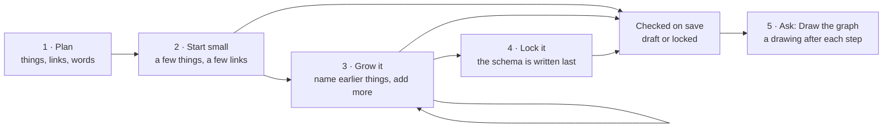

# How to write a graph note

**A guide, with a worked example that starts tiny and grows in five steps.** Every step is a real, checked graph with its own drawing. By the end you will know:

- **The ideas** — what a graph is made of, in plain words.
- **How to write one** — list things and the links between them; add more later; lock it when it is settled.
- **How to lay it out** — so a block reads like a list, not a wall of wrapped text.
- **How to turn it into a diagram** — one prompt, *"Draw the graph in this note"*, and where the drawing lands.

The rules behind all of this are in [[Graph spec model]]. This note is the practical way in.

## Three prompts to copy

**Use these with any AI.** The first gives an AI that cannot see this vault just enough to do graph work well. The second makes it remember that for good. The third checks the result with the vault's own tools. **The prompts carry the rules; you only add the topic.**

### Prompt 1 — paste at the start of any graph work

For a chat with an AI that cannot see the vault. Paste it, then add one line on what you want: *"Graph the options for replacing the car."*

```text
You are helping me write a "graph note": a Markdown note whose facts are a
graph, written in GQL (ISO/IEC 39075) inside fenced code blocks tagged gql.
Follow these rules exactly.

1. Every gql block starts with a comment line naming its graph:
     // graph: <name> · SOURCE
   The graph name is one word (letters, digits, underscores). Then just list
   things and links, comma-separated — no INSERT, no MATCH: the block is
   data, not a command. Values: 'single-quoted text', numbers, TRUE/FALSE,
   DATE '2026-10-06'.
2. A thing is (name:Kind {properties}). The name in front is its permanent
   id: one word, lower case with underscores, saying what it is
   (large_reader — never d or option1). Give each a name or title.
3. A link is (from)-[:TYPE]->(to), the TYPE in CAPITALS_WITH_UNDERSCORES
   (e.g. COUNTS_AGAINST). Write it once, from the side its reading starts —
   the reason FAVOURS the option. Never write the reverse.
4. A later block names things from earlier blocks by their name alone —
   (large_reader) — and adds to them. Add new facts; never rewrite old ones.
   SET large_reader.status = 'bought' only for a current state.
5. No schema: the graph is a draft until I say "lock the graph". Then add
   one final block: (<graph>_schema:GraphMeta {graph, schema:'<graph>@1',
   owner_engine:'engine:mac14', written_by}), one Meta:ElementType per kind
   {name, kind:'node', origin:'source'} and per link type {name,
   kind:'edge', origin:'source', reading, reverse_name}, each linked
   (<graph>_schema)-[:DECLARES]->(…).
6. Lay blocks out to read easily: lines under 70 characters; one short thing
   or link per line; a long thing split over lines; a "// ──" comment line
   before each part, and a blank line between parts.
7. Avoid these kinds unless I ask for their rules: Claim, Assessment,
   Finding, LikelihoodBand, Calibration, Proposal, Serving, Path, Lens, Ref.
8. Use only facts I give you. Where you assume something, say so in a list
   after the blocks.

Return, in order: (a) the plan — kinds and link types, each link with its
reading both ways ("favours" / "is favoured by"), in a short list; (b) the
gql blocks; (c) a Mermaid "flowchart LR" drawing — one box per thing, text
= name or title with the kind in italics, arrows labelled with the reading
(never the TYPE); (d) assumptions and questions. Ask before inventing a
kind or link I did not describe.
```

### Prompt 2 — make the AI remember it

Paste into the AI's standing instructions: in ChatGPT, *Settings → Personalisation → Custom instructions*, or say *"Remember this"*; in Claude, a Project's instructions or your profile preferences. Kept under about 1,500 characters, the usual limit for those fields.[^u]

```text
When I mention a "graph note": write its facts as GQL (ISO/IEC 39075) in
fenced blocks tagged gql, each starting "// graph: <name> · SOURCE" (graph
name one word). Blocks just list things and links: no INSERT, no MATCH. A
thing is (name:Kind {title: '…'}); the name in front is its permanent id —
lower case with underscores, saying what it is (large_reader, never d).
Links (from)-[:TYPE]->(to), TYPE in CAPITALS_WITH_UNDERSCORES, written
once, never reversed. Later blocks name earlier things by name alone.
Single-quoted text, DATE '…', TRUE/FALSE. No schema until I say "lock the
graph": then add a final block with a GraphMeta and one Meta:ElementType
per kind and link type (links with reading and reverse_name), each linked
by DECLARES. Lines under 70 characters; split long things over lines;
label parts with "// ──" comments. Avoid Claim, Assessment, Finding,
Proposal, Serving, Path, Lens, Ref unless asked. Use only facts I give;
list assumptions. End with a Mermaid flowchart LR whose arrows show each
reading, not the type. UK spelling.
```

### Prompt 3 — check it with the local tools

For an AI that can run commands on this Mac — Claude Code, Codex, or a local model with a shell. In Claude Code inside the vault the checks run on their own; use this anywhere else, or to fix a failing note.

```text
Validate the graph note at <path to the .md file> with the arbux vault's
own tools. Do not judge it by reading — run the checker. Python is
standard-library only. S = ~/Obsidian/arbux/zzSupport/_scripts

1. Run:  ~/.venvs/arbux/bin/python $S/graph-spec-check-docs.py --file "<path>"
   "passes" = done; "draft" means no schema yet, which is fine.
   "FAILS" lists each failed rule.
2. Fix only form, never facts: correct a misspelt name, split a block that
   holds two statements, make the graph name one word, straighten quotes.
   If a fix would change a fact, stop and ask me.
3. Re-run until it passes, at most three rounds; then report what still
   fails and why.
4. Only if I asked to lock it:
     ~/.venvs/arbux/bin/python $S/graph-spec-lock.py --write "<path>"
   then show me the reverse readings it guessed, to confirm.
5. Draw it:  ~/.venvs/arbux/bin/python $S/graph-spec-draw.py --write "<path>"
6. Report: the final verdict, each change you made and why, and anything
   you assumed.
If you cannot run commands, say so, and tell me to paste the gql blocks
into $S/graph-checker.html, which checks offline.
```



## 1. The ideas, in plain words

- **A graph is things and the links between them.** Nothing more. A project and its tasks, a question and its options, a person and the loans they made.
- **A thing (a *node*)** has a **kind** saying what sort of thing it is — `Question`, `Option`, `Person` — and **properties**, its facts: a title, a date, an amount.
- **Every thing has a name, and the name is its permanent id** — `large_reader`, `buy_large_reader`. One word, lower case, saying what it is. Titles can change; the name does not. Links and later blocks find a thing by its name.
- **A link (a *relationship*)** joins one thing to another, in one direction, and has a **type** such as `ANSWERS`. It can carry facts too — a date, a page.
- **The type is an identifier, not a sentence.** It is short, has no spaces, and by convention is in capitals (`COUNTS_AGAINST`). Capitals tell a relationship from a kind of thing (`Option`) at a glance. They are a convention, not a rule.
- **Every relationship reads both ways.** `ANSWERS` reads *answers* forwards and *is answered by* backwards. You write the link once; the other direction is worked out, never written twice. **The diagram shows the words, not the type.**
- **A graph is a draft until you lock it.** While it is a draft, the checker works out its kinds and relationship types from the data. **Locking writes the schema** — the graph's dictionary of kinds, types and readings — and from then on anything new must be declared, which stops typos and drift once the graph is relied on.
- **A graph lives in `gql` code blocks** — GQL is the international standard language for graphs (ISO/IEC 39075). Each block starts with a line naming its graph: `// graph: reader · SOURCE`. **A graph name is one word** — letters, digits and underscores (`reader_choice`, not `reader-choice`), because that is all a graph database accepts.
- **A block is the graph's data, not a command.** Think of it as the CSV of a graph: a plain list of things and links that any graph tool can load. When the vault's tools hand a block to a graph database, they add the commands it needs — `INSERT`, and `MATCH` to find things named from earlier blocks. You never write them.
- **The format describes itself, in its own language.** Its own vocabulary is a graph in [[Graph spec meta-schema]], and every rule of the format is a node in [[Graph spec requirements]], linked to the test that proves it — shown on the rule card, [[Graph spec requirements — trace report]].

**Some kinds of thing are reserved — they bring extra rules.** `Claim`, `Assessment`, `Finding`, `LikelihoodBand` and `Calibration` switch on the certainty rules (§20: every claim needs an assessed likelihood). `Proposal` and `Serving` are for AI drafts (§23–24); `Path`, `Lens` and `Ref` are for altitudes, groupings and links to other graphs (§15–22). Use them when you mean them; otherwise pick your own word — the example uses `Reason`, not `Claim`.

**Three habits keep a graph honest:** one fact per statement · names that say what a thing is · never write the reverse of a link.

## 2. Plan before you type

Answer three questions on paper first. The worked example — *which device to read long PDFs on* — is an illustration, not a real decision.

- **What kinds of things?** A `Question`, the `Option`s that answer it, the `Reason`s for and against them, the `Source` a reason cites, and the `Decision` that settles it.
- **What relationships, and from which side?** An option *answers* the question. A reason *favours* or *counts against* an option. A reason *cites* a source. A decision *decides* the question and *chose* an option.
- **What words, both ways?** *favours* / *is favoured by*, *cites* / *is cited by*, and so on. If a reading sounds odd backwards, the direction is probably wrong.

**You do not have to write it all at once.** The example starts with four things and grows a step at a time:

```text
Step 1   Option ──answers──► Question        the smallest graph
Step 2   Reason ──favours──► Option          name earlier things,
         Reason ──counts against──► Option   add more
Step 3   Reason ──cites──► Source            facts on a link
Step 4   Decision ──decides──► Question      a change of state
         Decision ──chose──► Option
Step 5   lock it                             the schema, written last
```

## 3. Lay a block out so it reads easily

**Spaces and line breaks never change what a block means**, so use them to make it read like a list.

- **Keep lines under about 70 characters.** That fits Obsidian's reading width on a laptop, so nothing wraps. On a phone, lines still wrap — turn it sideways.
- **One short thing or link per line.** Line up the short ones with spaces so names and titles form columns.
- **Split a long thing over lines** — the name and kind on the first, one property per line after. The closing `})` ends its last line.
- **Label the parts with `//` lines** — `// ── The options ──`. A line starting `//` is a note for people; tools skip it. The one exception is the block's first line, which names the graph.
- **A blank line between parts** — the things, then the links.

## 4. Step 1 — the smallest graph

**Set up the note as any note** — `uuid`, `created`, `tags`, `classification`, `human_reviewed: false`. Then one block: the things, then the links, separated by commas. Nothing else.

```gql
// graph: reader · SOURCE
// ── The question ──
(reader_question:Question {
    title: 'Which device should I read long PDFs on?'}),

// ── The options ──
(large_reader:Option {name: 'Large e-ink reader'}),
(small_reader:Option {name: 'Small e-ink reader'}),
(tablet:Option       {name: 'Keep using the tablet'}),

// ── Each option answers the question ──
(large_reader)-[:ANSWERS]->(reader_question),
(small_reader)-[:ANSWERS]->(reader_question),
(tablet)-[:ANSWERS]->(reader_question)
```

**How to read one thing:** `(large_reader:Option {name: 'Large e-ink reader'})` is a thing called `large_reader`, of kind `Option`, with its properties in braces. **The name in front is its id, for good.** `(large_reader)-[:ANSWERS]->(reader_question)` links it to the question; the arrow runs from the side the reading starts — the option *answers* the question.

**What you have now:**

<!-- graph-drawing:start — generated by zzSupport/_scripts/graph-spec-draw.py; do not hand-edit -->
> [!info] Drawn from the graph above by `zzSupport/_scripts/graph-spec-draw.py` — edit the graph, then ask again: *Draw the graph in this note.*

**Graph `reader`** — 4 things, 3 relationships · ✅ passes its checks

<div class="mermaid graph-svg">
<svg width="545" style="max-width:100%;height:auto;filter:none"
viewBox="0.00 0.00 409.00 246.00" xmlns="http://www.w3.org/2000/svg" xmlns:xlink="http://www.w3.org/1999/xlink">
<g id="graph0" class="graph" transform="scale(1 1) rotate(0) translate(7.2 238.3)">
<g id="node1" class="node">
<path style="fill:rgba(var(--color-orange-rgb), 0.16);stroke:color-mix(in srgb, var(--color-orange) 75%, var(--text-normal))" stroke-width="1.2" d="M382.62,-149.97C382.62,-149.97 247.31,-149.97 247.31,-149.97 241.31,-149.97 235.31,-143.97 235.31,-137.97 235.31,-137.97 235.31,-93.12 235.31,-93.12 235.31,-87.12 241.31,-81.12 247.31,-81.12 247.31,-81.12 382.62,-81.12 382.62,-81.12 388.62,-81.12 394.62,-87.12 394.62,-93.12 394.62,-93.12 394.62,-137.97 394.62,-137.97 394.62,-143.97 388.62,-149.97 382.62,-149.97"/>
<text style="fill:var(--text-muted)" letter-spacing="0.72" xml:space="preserve" text-anchor="start" x="288.84" y="-130.68" font-family="Helvetica,sans-Serif" font-size="9.00">QUESTION</text>
<text style="fill:var(--text-normal)" xml:space="preserve" text-anchor="start" x="254.59" y="-112.67" font-family="Helvetica,sans-Serif" font-size="12.50">Which device should I</text>
<text style="fill:var(--text-normal)" xml:space="preserve" text-anchor="start" x="259.84" y="-96.92" font-family="Helvetica,sans-Serif" font-size="12.50">read long PDFs on?</text>
</g>
<g id="node2" class="node">
<path style="fill:rgba(var(--color-pink-rgb), 0.16);stroke:color-mix(in srgb, var(--color-pink) 75%, var(--text-normal))" stroke-width="1.2" d="M136.06,-231.1C136.06,-231.1 19.5,-231.1 19.5,-231.1 13.5,-231.1 7.5,-225.1 7.5,-219.1 7.5,-219.1 7.5,-190 7.5,-190 7.5,-184 13.5,-178 19.5,-178 19.5,-178 136.06,-178 136.06,-178 142.06,-178 148.06,-184 148.06,-190 148.06,-190 148.06,-219.1 148.06,-219.1 148.06,-225.1 142.06,-231.1 136.06,-231.1"/>
<text style="fill:var(--text-muted)" letter-spacing="0.72" xml:space="preserve" text-anchor="start" x="58.74" y="-211.8" font-family="Helvetica,sans-Serif" font-size="9.00">OPTION</text>
<text style="fill:var(--text-normal)" xml:space="preserve" text-anchor="start" x="26.78" y="-193.8" font-family="Helvetica,sans-Serif" font-size="12.50">Large e&#45;ink reader</text>
</g>
<g id="edge1" class="edge">
<path style="stroke:color-mix(in srgb, var(--color-cyan) 75%, var(--text-normal))" fill="none" d="M148.39,-178.21C173.17,-168.83 201.38,-158.16 227.4,-148.31"/>
<polygon style="fill:color-mix(in srgb, var(--color-cyan) 75%, var(--text-normal));stroke:color-mix(in srgb, var(--color-cyan) 75%, var(--text-normal))" points="227.95,-150.72 233.63,-145.95 226.21,-146.14 227.95,-150.72"/>
<text style="fill:color-mix(in srgb, var(--color-cyan) 50%, var(--text-normal))" xml:space="preserve" text-anchor="middle" x="195.44" y="-166.65" font-family="Helvetica,sans-Serif" font-size="10.50">answers</text>
</g>
<g id="node3" class="node">
<path style="fill:rgba(var(--color-pink-rgb), 0.16);stroke:color-mix(in srgb, var(--color-pink) 75%, var(--text-normal))" stroke-width="1.2" d="M136.06,-142.1C136.06,-142.1 19.5,-142.1 19.5,-142.1 13.5,-142.1 7.5,-136.1 7.5,-130.1 7.5,-130.1 7.5,-101 7.5,-101 7.5,-95 13.5,-89 19.5,-89 19.5,-89 136.06,-89 136.06,-89 142.06,-89 148.06,-95 148.06,-101 148.06,-101 148.06,-130.1 148.06,-130.1 148.06,-136.1 142.06,-142.1 136.06,-142.1"/>
<text style="fill:var(--text-muted)" letter-spacing="0.72" xml:space="preserve" text-anchor="start" x="58.74" y="-122.8" font-family="Helvetica,sans-Serif" font-size="9.00">OPTION</text>
<text style="fill:var(--text-normal)" xml:space="preserve" text-anchor="start" x="26.78" y="-104.8" font-family="Helvetica,sans-Serif" font-size="12.50">Small e&#45;ink reader</text>
</g>
<g id="edge2" class="edge">
<path style="stroke:color-mix(in srgb, var(--color-cyan) 75%, var(--text-normal))" fill="none" d="M148.39,-115.55C172.96,-115.55 200.89,-115.55 226.73,-115.55"/>
<polygon style="fill:color-mix(in srgb, var(--color-cyan) 75%, var(--text-normal));stroke:color-mix(in srgb, var(--color-cyan) 75%, var(--text-normal))" points="226.53,-118 233.53,-115.55 226.53,-113.1 226.53,-118"/>
<text style="fill:color-mix(in srgb, var(--color-cyan) 50%, var(--text-normal))" xml:space="preserve" text-anchor="middle" x="195.44" y="-116.83" font-family="Helvetica,sans-Serif" font-size="10.50">answers</text>
</g>
<g id="node4" class="node">
<path style="fill:rgba(var(--color-pink-rgb), 0.16);stroke:color-mix(in srgb, var(--color-pink) 75%, var(--text-normal))" stroke-width="1.2" d="M143.56,-53.1C143.56,-53.1 12,-53.1 12,-53.1 6,-53.1 0,-47.1 0,-41.1 0,-41.1 0,-12 0,-12 0,-6 6,0 12,0 12,0 143.56,0 143.56,0 149.56,0 155.56,-6 155.56,-12 155.56,-12 155.56,-41.1 155.56,-41.1 155.56,-47.1 149.56,-53.1 143.56,-53.1"/>
<text style="fill:var(--text-muted)" letter-spacing="0.72" xml:space="preserve" text-anchor="start" x="58.74" y="-33.8" font-family="Helvetica,sans-Serif" font-size="9.00">OPTION</text>
<text style="fill:var(--text-normal)" xml:space="preserve" text-anchor="start" x="19.28" y="-15.8" font-family="Helvetica,sans-Serif" font-size="12.50">Keep using the tablet</text>
</g>
<g id="edge3" class="edge">
<path style="stroke:color-mix(in srgb, var(--color-cyan) 75%, var(--text-normal))" fill="none" d="M150.3,-53.62C174.55,-62.79 201.91,-73.14 227.21,-82.72"/>
<polygon style="fill:color-mix(in srgb, var(--color-cyan) 75%, var(--text-normal));stroke:color-mix(in srgb, var(--color-cyan) 75%, var(--text-normal))" points="226.16,-84.94 233.58,-85.13 227.9,-80.36 226.16,-84.94"/>
<text style="fill:color-mix(in srgb, var(--color-cyan) 50%, var(--text-normal))" xml:space="preserve" text-anchor="middle" x="195.44" y="-77.65" font-family="Helvetica,sans-Serif" font-size="10.50">answers</text>
</g>
</g>
</svg>
</div>

*Relationships drawn:* *answers* = `ANSWERS`
<!-- graph-drawing:end -->

## 5. Step 2 — reasons for and against: growing the graph

**A new block adds to the graph without touching the old one.** To link to a thing from an earlier block, write its name alone — `(large_reader)`. Nothing else is needed.

```gql
// graph: reader · SOURCE
// ── Reasons ──
(a4_pages:Reason {
    title: 'A4 pages need a screen of about 10 inches or more'}),
(easy_on_eyes:Reason {
    title: 'E-ink is easier on the eyes over long sessions'}),
(costs_nothing:Reason {
    title: 'The tablet costs nothing extra'}),

// ── What each reason favours, or counts against ──
(a4_pages)-[:FAVOURS]->(large_reader),
(a4_pages)-[:COUNTS_AGAINST]->(small_reader),
(easy_on_eyes)-[:FAVOURS]->(large_reader),
(easy_on_eyes)-[:FAVOURS]->(small_reader),
(costs_nothing)-[:FAVOURS]->(tablet)
```

- **A misspelt name is refused**, not turned into a new thing: `(large_raeder)` fails with *no thing called large_raeder*.
- **Never edit an old fact to change history — add a new one.** The step-1 block is left exactly as it was.
- **One reason can point at several options**, each with its own link — `a4_pages` favours one and counts against another.

**What you have now:**

<!-- graph-drawing:start — generated by zzSupport/_scripts/graph-spec-draw.py; do not hand-edit -->
> [!info] Drawn from the graph above by `zzSupport/_scripts/graph-spec-draw.py` — edit the graph, then ask again: *Draw the graph in this note.*

**Graph `reader`** — 7 things, 8 relationships · ✅ passes its checks

<div class="mermaid graph-svg">
<svg width="771" style="max-width:100%;height:auto;filter:none"
viewBox="0.00 0.00 578.00 323.00" xmlns="http://www.w3.org/2000/svg" xmlns:xlink="http://www.w3.org/1999/xlink">
<g id="graph0" class="graph" transform="scale(1 1) rotate(0) translate(7.2 316.25)">
<g id="node1" class="node">
<path style="fill:rgba(var(--color-orange-rgb), 0.16);stroke:color-mix(in srgb, var(--color-orange) 75%, var(--text-normal))" stroke-width="1.2" d="M369.43,-68.85C369.43,-68.85 234.12,-68.85 234.12,-68.85 228.12,-68.85 222.12,-62.85 222.12,-56.85 222.12,-56.85 222.12,-12 222.12,-12 222.12,-6 228.12,0 234.12,0 234.12,0 369.43,0 369.43,0 375.43,0 381.43,-6 381.43,-12 381.43,-12 381.43,-56.85 381.43,-56.85 381.43,-62.85 375.43,-68.85 369.43,-68.85"/>
<text style="fill:var(--text-muted)" letter-spacing="0.72" xml:space="preserve" text-anchor="start" x="275.65" y="-49.55" font-family="Helvetica,sans-Serif" font-size="9.00">QUESTION</text>
<text style="fill:var(--text-normal)" xml:space="preserve" text-anchor="start" x="241.4" y="-31.55" font-family="Helvetica,sans-Serif" font-size="12.50">Which device should I</text>
<text style="fill:var(--text-normal)" xml:space="preserve" text-anchor="start" x="246.65" y="-15.8" font-family="Helvetica,sans-Serif" font-size="12.50">read long PDFs on?</text>
</g>
<g id="node2" class="node">
<path style="fill:rgba(var(--color-pink-rgb), 0.16);stroke:color-mix(in srgb, var(--color-pink) 75%, var(--text-normal))" stroke-width="1.2" d="M360.06,-173.2C360.06,-173.2 243.5,-173.2 243.5,-173.2 237.5,-173.2 231.5,-167.2 231.5,-161.2 231.5,-161.2 231.5,-132.1 231.5,-132.1 231.5,-126.1 237.5,-120.1 243.5,-120.1 243.5,-120.1 360.06,-120.1 360.06,-120.1 366.06,-120.1 372.06,-126.1 372.06,-132.1 372.06,-132.1 372.06,-161.2 372.06,-161.2 372.06,-167.2 366.06,-173.2 360.06,-173.2"/>
<text style="fill:var(--text-muted)" letter-spacing="0.72" xml:space="preserve" text-anchor="start" x="282.74" y="-153.9" font-family="Helvetica,sans-Serif" font-size="9.00">OPTION</text>
<text style="fill:var(--text-normal)" xml:space="preserve" text-anchor="start" x="250.78" y="-135.9" font-family="Helvetica,sans-Serif" font-size="12.50">Large e&#45;ink reader</text>
</g>
<g id="edge1" class="edge">
<path style="stroke:color-mix(in srgb, var(--color-cyan) 75%, var(--text-normal))" fill="none" d="M301.78,-119.53C301.78,-106.97 301.78,-91.6 301.78,-77.45"/>
<polygon style="fill:color-mix(in srgb, var(--color-cyan) 75%, var(--text-normal));stroke:color-mix(in srgb, var(--color-cyan) 75%, var(--text-normal))" points="304.23,-77.81 301.78,-70.81 299.33,-77.81 304.23,-77.81"/>
<text style="fill:color-mix(in srgb, var(--color-cyan) 50%, var(--text-normal))" xml:space="preserve" text-anchor="middle" x="321.65" y="-90.12" font-family="Helvetica,sans-Serif" font-size="10.50">answers</text>
</g>
<g id="node3" class="node">
<path style="fill:rgba(var(--color-pink-rgb), 0.16);stroke:color-mix(in srgb, var(--color-pink) 75%, var(--text-normal))" stroke-width="1.2" d="M183.06,-173.2C183.06,-173.2 66.5,-173.2 66.5,-173.2 60.5,-173.2 54.5,-167.2 54.5,-161.2 54.5,-161.2 54.5,-132.1 54.5,-132.1 54.5,-126.1 60.5,-120.1 66.5,-120.1 66.5,-120.1 183.06,-120.1 183.06,-120.1 189.06,-120.1 195.06,-126.1 195.06,-132.1 195.06,-132.1 195.06,-161.2 195.06,-161.2 195.06,-167.2 189.06,-173.2 183.06,-173.2"/>
<text style="fill:var(--text-muted)" letter-spacing="0.72" xml:space="preserve" text-anchor="start" x="105.75" y="-153.9" font-family="Helvetica,sans-Serif" font-size="9.00">OPTION</text>
<text style="fill:var(--text-normal)" xml:space="preserve" text-anchor="start" x="73.78" y="-135.9" font-family="Helvetica,sans-Serif" font-size="12.50">Small e&#45;ink reader</text>
</g>
<g id="edge2" class="edge">
<path style="stroke:color-mix(in srgb, var(--color-cyan) 75%, var(--text-normal))" fill="none" d="M166.73,-119.53C188.69,-105.85 215.99,-88.85 240.29,-73.72"/>
<polygon style="fill:color-mix(in srgb, var(--color-cyan) 75%, var(--text-normal));stroke:color-mix(in srgb, var(--color-cyan) 75%, var(--text-normal))" points="241.46,-75.88 246.1,-70.1 238.87,-71.72 241.46,-75.88"/>
<text style="fill:color-mix(in srgb, var(--color-cyan) 50%, var(--text-normal))" xml:space="preserve" text-anchor="middle" x="233.16" y="-90.12" font-family="Helvetica,sans-Serif" font-size="10.50">answers</text>
</g>
<g id="node4" class="node">
<path style="fill:rgba(var(--color-pink-rgb), 0.16);stroke:color-mix(in srgb, var(--color-pink) 75%, var(--text-normal))" stroke-width="1.2" d="M551.56,-173.2C551.56,-173.2 420,-173.2 420,-173.2 414,-173.2 408,-167.2 408,-161.2 408,-161.2 408,-132.1 408,-132.1 408,-126.1 414,-120.1 420,-120.1 420,-120.1 551.56,-120.1 551.56,-120.1 557.56,-120.1 563.56,-126.1 563.56,-132.1 563.56,-132.1 563.56,-161.2 563.56,-161.2 563.56,-167.2 557.56,-173.2 551.56,-173.2"/>
<text style="fill:var(--text-muted)" letter-spacing="0.72" xml:space="preserve" text-anchor="start" x="466.74" y="-153.9" font-family="Helvetica,sans-Serif" font-size="9.00">OPTION</text>
<text style="fill:var(--text-normal)" xml:space="preserve" text-anchor="start" x="427.28" y="-135.9" font-family="Helvetica,sans-Serif" font-size="12.50">Keep using the tablet</text>
</g>
<g id="edge3" class="edge">
<path style="stroke:color-mix(in srgb, var(--color-cyan) 75%, var(--text-normal))" fill="none" d="M442.17,-119.53C419.25,-105.8 390.72,-88.7 365.38,-73.52"/>
<polygon style="fill:color-mix(in srgb, var(--color-cyan) 75%, var(--text-normal));stroke:color-mix(in srgb, var(--color-cyan) 75%, var(--text-normal))" points="366.89,-71.57 359.62,-70.07 364.37,-75.77 366.89,-71.57"/>
<text style="fill:color-mix(in srgb, var(--color-cyan) 50%, var(--text-normal))" xml:space="preserve" text-anchor="middle" x="424.67" y="-90.12" font-family="Helvetica,sans-Serif" font-size="10.50">answers</text>
</g>
<g id="node5" class="node">
<path style="fill:rgba(var(--color-blue-rgb), 0.16);stroke:color-mix(in srgb, var(--color-blue) 75%, var(--text-normal))" stroke-width="1.2" d="M366.81,-309.05C366.81,-309.05 218.75,-309.05 218.75,-309.05 212.75,-309.05 206.75,-303.05 206.75,-297.05 206.75,-297.05 206.75,-236.45 206.75,-236.45 206.75,-230.45 212.75,-224.45 218.75,-224.45 218.75,-224.45 366.81,-224.45 366.81,-224.45 372.81,-224.45 378.81,-230.45 378.81,-236.45 378.81,-236.45 378.81,-297.05 378.81,-297.05 378.81,-303.05 372.81,-309.05 366.81,-309.05"/>
<text style="fill:var(--text-muted)" letter-spacing="0.72" xml:space="preserve" text-anchor="start" x="271.49" y="-289.75" font-family="Helvetica,sans-Serif" font-size="9.00">REASON</text>
<text style="fill:var(--text-normal)" xml:space="preserve" text-anchor="start" x="226.03" y="-271.75" font-family="Helvetica,sans-Serif" font-size="12.50">A4 pages need a screen</text>
<text style="fill:var(--text-normal)" xml:space="preserve" text-anchor="start" x="234.65" y="-256" font-family="Helvetica,sans-Serif" font-size="12.50">of about 10 inches or</text>
<text style="fill:var(--text-normal)" xml:space="preserve" text-anchor="start" x="278.53" y="-240.25" font-family="Helvetica,sans-Serif" font-size="12.50">more</text>
</g>
<g id="edge4" class="edge">
<path style="stroke:color-mix(in srgb, var(--color-green) 75%, var(--text-normal))" fill="none" d="M295.95,-224.11C297.01,-210.28 298.17,-195.04 299.18,-181.83"/>
<polygon style="fill:color-mix(in srgb, var(--color-green) 75%, var(--text-normal));stroke:color-mix(in srgb, var(--color-green) 75%, var(--text-normal))" points="301.61,-182.15 299.7,-174.99 296.72,-181.78 301.61,-182.15"/>
<text style="fill:color-mix(in srgb, var(--color-green) 50%, var(--text-normal))" xml:space="preserve" text-anchor="middle" x="315.71" y="-194.47" font-family="Helvetica,sans-Serif" font-size="10.50">favours</text>
</g>
<g id="edge5" class="edge">
<path style="stroke:color-mix(in srgb, var(--color-red) 75%, var(--text-normal))" fill="none" d="M233.55,-224.11C212.09,-209.02 188.25,-192.27 168.38,-178.3"/>
<polygon style="fill:color-mix(in srgb, var(--color-red) 75%, var(--text-normal));stroke:color-mix(in srgb, var(--color-red) 75%, var(--text-normal))" points="169.9,-176.37 162.76,-174.35 167.08,-180.38 169.9,-176.37"/>
<text style="fill:color-mix(in srgb, var(--color-red) 50%, var(--text-normal))" xml:space="preserve" text-anchor="middle" x="238.24" y="-194.47" font-family="Helvetica,sans-Serif" font-size="10.50">counts against</text>
</g>
<g id="node6" class="node">
<path style="fill:rgba(var(--color-blue-rgb), 0.16);stroke:color-mix(in srgb, var(--color-blue) 75%, var(--text-normal))" stroke-width="1.2" d="M143.56,-309.05C143.56,-309.05 12,-309.05 12,-309.05 6,-309.05 0,-303.05 0,-297.05 0,-297.05 0,-236.45 0,-236.45 0,-230.45 6,-224.45 12,-224.45 12,-224.45 143.56,-224.45 143.56,-224.45 149.56,-224.45 155.56,-230.45 155.56,-236.45 155.56,-236.45 155.56,-297.05 155.56,-297.05 155.56,-303.05 149.56,-309.05 143.56,-309.05"/>
<text style="fill:var(--text-muted)" letter-spacing="0.72" xml:space="preserve" text-anchor="start" x="56.50" y="-289.75" font-family="Helvetica,sans-Serif" font-size="9.00">REASON</text>
<text style="fill:var(--text-normal)" xml:space="preserve" text-anchor="start" x="19.28" y="-271.75" font-family="Helvetica,sans-Serif" font-size="12.50">E&#45;ink is easier on the</text>
<text style="fill:var(--text-normal)" xml:space="preserve" text-anchor="start" x="37.66" y="-256" font-family="Helvetica,sans-Serif" font-size="12.50">eyes over long</text>
<text style="fill:var(--text-normal)" xml:space="preserve" text-anchor="start" x="54.16" y="-240.25" font-family="Helvetica,sans-Serif" font-size="12.50">sessions</text>
</g>
<g id="edge6" class="edge">
<path style="stroke:color-mix(in srgb, var(--color-green) 75%, var(--text-normal))" fill="none" d="M111.92,-224.15C122.94,-212.81 135.86,-201.41 149.53,-193.2 153.13,-191.04 187.76,-180.62 223.09,-170.3"/>
<polygon style="fill:color-mix(in srgb, var(--color-green) 75%, var(--text-normal));stroke:color-mix(in srgb, var(--color-green) 75%, var(--text-normal))" points="223.61,-172.7 229.65,-168.38 222.24,-167.99 223.61,-172.7"/>
<text style="fill:color-mix(in srgb, var(--color-green) 50%, var(--text-normal))" xml:space="preserve" text-anchor="middle" x="167.16" y="-194.47" font-family="Helvetica,sans-Serif" font-size="10.50">favours</text>
</g>
<g id="edge7" class="edge">
<path style="stroke:color-mix(in srgb, var(--color-green) 75%, var(--text-normal))" fill="none" d="M43.65,-224.04C39.16,-213.77 37.83,-202.93 43.53,-193.2 46.62,-187.92 50.57,-183.21 55.06,-179.01"/>
<polygon style="fill:color-mix(in srgb, var(--color-green) 75%, var(--text-normal));stroke:color-mix(in srgb, var(--color-green) 75%, var(--text-normal))" points="56.55,-180.96 60.33,-174.58 53.39,-177.21 56.55,-180.96"/>
<text style="fill:color-mix(in srgb, var(--color-green) 50%, var(--text-normal))" xml:space="preserve" text-anchor="middle" x="61.16" y="-194.47" font-family="Helvetica,sans-Serif" font-size="10.50">favours</text>
</g>
<g id="node7" class="node">
<path style="fill:rgba(var(--color-blue-rgb), 0.16);stroke:color-mix(in srgb, var(--color-blue) 75%, var(--text-normal))" stroke-width="1.2" d="M536.93,-301.18C536.93,-301.18 434.62,-301.18 434.62,-301.18 428.62,-301.18 422.62,-295.18 422.62,-289.18 422.62,-289.18 422.62,-244.32 422.62,-244.32 422.62,-238.32 428.62,-232.32 434.62,-232.32 434.62,-232.32 536.93,-232.32 536.93,-232.32 542.93,-232.32 548.93,-238.32 548.93,-244.32 548.93,-244.32 548.93,-289.18 548.93,-289.18 548.93,-295.18 542.93,-301.18 536.93,-301.18"/>
<text style="fill:var(--text-muted)" letter-spacing="0.72" xml:space="preserve" text-anchor="start" x="464.49" y="-281.88" font-family="Helvetica,sans-Serif" font-size="9.00">REASON</text>
<text style="fill:var(--text-normal)" xml:space="preserve" text-anchor="start" x="441.9" y="-263.88" font-family="Helvetica,sans-Serif" font-size="12.50">The tablet costs</text>
<text style="fill:var(--text-normal)" xml:space="preserve" text-anchor="start" x="449.78" y="-248.12" font-family="Helvetica,sans-Serif" font-size="12.50">nothing extra</text>
</g>
<g id="edge8" class="edge">
<path style="stroke:color-mix(in srgb, var(--color-green) 75%, var(--text-normal))" fill="none" d="M485.78,-231.91C485.78,-216.26 485.78,-197.72 485.78,-182.01"/>
<polygon style="fill:color-mix(in srgb, var(--color-green) 75%, var(--text-normal));stroke:color-mix(in srgb, var(--color-green) 75%, var(--text-normal))" points="488.23,-182.13 485.78,-175.13 483.33,-182.13 488.23,-182.13"/>
<text style="fill:color-mix(in srgb, var(--color-green) 50%, var(--text-normal))" xml:space="preserve" text-anchor="middle" x="503.4" y="-194.47" font-family="Helvetica,sans-Serif" font-size="10.50">favours</text>
</g>
</g>
</svg>
</div>

*Relationships drawn:* *answers* = `ANSWERS` · *counts against* = `COUNTS_AGAINST` · *favours* = `FAVOURS`
<!-- graph-drawing:end -->

## 6. Step 3 — evidence, and facts on a link

**A link can carry properties, like a thing.** Here each *cites* link says where in the trial notes the reason comes from. The step also adds a reason found later — the large reader is heavy.

```gql
// graph: reader · SOURCE
// ── Where the reasons come from ──
(trial_notes:Source {
    title: 'Notes from a two-week trial',
    started: DATE '2026-09-21'}),
(too_heavy:Reason {
    title: 'The large reader is heavy to hold one-handed'}),

// ── Links that carry a fact: where in the notes ──
(a4_pages)-[:CITES     {where: 'day 2'}]->(trial_notes),
(easy_on_eyes)-[:CITES {where: 'days 5 to 9'}]->(trial_notes),
(too_heavy)-[:CITES    {where: 'day 11'}]->(trial_notes),
(too_heavy)-[:COUNTS_AGAINST]->(large_reader)
```

- **Text in single quotes**; a date as `DATE '2026-09-21'`; numbers bare; `TRUE` / `FALSE`.
- **A link's properties go inside its brackets** — `-[:CITES {where: 'day 2'}]->`. The drawing shows the reading, not the properties; they are there for questions and reports.

**What you have now:**

<!-- graph-drawing:start — generated by zzSupport/_scripts/graph-spec-draw.py; do not hand-edit -->
> [!info] Drawn from the graph above by `zzSupport/_scripts/graph-spec-draw.py` — edit the graph, then ask again: *Draw the graph in this note.*

**Graph `reader`** — 9 things, 12 relationships · ✅ passes its checks

<div class="mermaid graph-svg">
<svg width="961" style="max-width:100%;height:auto;filter:none"
viewBox="0.00 0.00 721.00 444.00" xmlns="http://www.w3.org/2000/svg" xmlns:xlink="http://www.w3.org/1999/xlink">
<g id="graph0" class="graph" transform="scale(1 1) rotate(0) translate(7.2 436.35)">
<g id="node1" class="node">
<path style="fill:rgba(var(--color-orange-rgb), 0.16);stroke:color-mix(in srgb, var(--color-orange) 75%, var(--text-normal))" stroke-width="1.2" d="M456.68,-68.85C456.68,-68.85 321.38,-68.85 321.38,-68.85 315.38,-68.85 309.38,-62.85 309.38,-56.85 309.38,-56.85 309.38,-12 309.38,-12 309.38,-6 315.38,0 321.38,0 321.38,0 456.68,0 456.68,0 462.68,0 468.68,-6 468.68,-12 468.68,-12 468.68,-56.85 468.68,-56.85 468.68,-62.85 462.68,-68.85 456.68,-68.85"/>
<text style="fill:var(--text-muted)" letter-spacing="0.72" xml:space="preserve" text-anchor="start" x="362.90" y="-49.55" font-family="Helvetica,sans-Serif" font-size="9.00">QUESTION</text>
<text style="fill:var(--text-normal)" xml:space="preserve" text-anchor="start" x="328.65" y="-31.55" font-family="Helvetica,sans-Serif" font-size="12.50">Which device should I</text>
<text style="fill:var(--text-normal)" xml:space="preserve" text-anchor="start" x="333.9" y="-15.8" font-family="Helvetica,sans-Serif" font-size="12.50">read long PDFs on?</text>
</g>
<g id="node2" class="node">
<path style="fill:rgba(var(--color-pink-rgb), 0.16);stroke:color-mix(in srgb, var(--color-pink) 75%, var(--text-normal))" stroke-width="1.2" d="M447.31,-173.2C447.31,-173.2 330.75,-173.2 330.75,-173.2 324.75,-173.2 318.75,-167.2 318.75,-161.2 318.75,-161.2 318.75,-132.1 318.75,-132.1 318.75,-126.1 324.75,-120.1 330.75,-120.1 330.75,-120.1 447.31,-120.1 447.31,-120.1 453.31,-120.1 459.31,-126.1 459.31,-132.1 459.31,-132.1 459.31,-161.2 459.31,-161.2 459.31,-167.2 453.31,-173.2 447.31,-173.2"/>
<text style="fill:var(--text-muted)" letter-spacing="0.72" xml:space="preserve" text-anchor="start" x="369.99" y="-153.9" font-family="Helvetica,sans-Serif" font-size="9.00">OPTION</text>
<text style="fill:var(--text-normal)" xml:space="preserve" text-anchor="start" x="338.03" y="-135.9" font-family="Helvetica,sans-Serif" font-size="12.50">Large e&#45;ink reader</text>
</g>
<g id="edge1" class="edge">
<path style="stroke:color-mix(in srgb, var(--color-cyan) 75%, var(--text-normal))" fill="none" d="M389.03,-119.53C389.03,-106.97 389.03,-91.6 389.03,-77.45"/>
<polygon style="fill:color-mix(in srgb, var(--color-cyan) 75%, var(--text-normal));stroke:color-mix(in srgb, var(--color-cyan) 75%, var(--text-normal))" points="391.48,-77.81 389.03,-70.81 386.58,-77.81 391.48,-77.81"/>
<text style="fill:color-mix(in srgb, var(--color-cyan) 50%, var(--text-normal))" xml:space="preserve" text-anchor="middle" x="408.9" y="-90.12" font-family="Helvetica,sans-Serif" font-size="10.50">answers</text>
</g>
<g id="node3" class="node">
<path style="fill:rgba(var(--color-pink-rgb), 0.16);stroke:color-mix(in srgb, var(--color-pink) 75%, var(--text-normal))" stroke-width="1.2" d="M270.31,-173.2C270.31,-173.2 153.75,-173.2 153.75,-173.2 147.75,-173.2 141.75,-167.2 141.75,-161.2 141.75,-161.2 141.75,-132.1 141.75,-132.1 141.75,-126.1 147.75,-120.1 153.75,-120.1 153.75,-120.1 270.31,-120.1 270.31,-120.1 276.31,-120.1 282.31,-126.1 282.31,-132.1 282.31,-132.1 282.31,-161.2 282.31,-161.2 282.31,-167.2 276.31,-173.2 270.31,-173.2"/>
<text style="fill:var(--text-muted)" letter-spacing="0.72" xml:space="preserve" text-anchor="start" x="193.00" y="-153.9" font-family="Helvetica,sans-Serif" font-size="9.00">OPTION</text>
<text style="fill:var(--text-normal)" xml:space="preserve" text-anchor="start" x="161.03" y="-135.9" font-family="Helvetica,sans-Serif" font-size="12.50">Small e&#45;ink reader</text>
</g>
<g id="edge2" class="edge">
<path style="stroke:color-mix(in srgb, var(--color-cyan) 75%, var(--text-normal))" fill="none" d="M253.98,-119.53C275.94,-105.85 303.24,-88.85 327.54,-73.72"/>
<polygon style="fill:color-mix(in srgb, var(--color-cyan) 75%, var(--text-normal));stroke:color-mix(in srgb, var(--color-cyan) 75%, var(--text-normal))" points="328.71,-75.88 333.35,-70.1 326.12,-71.72 328.71,-75.88"/>
<text style="fill:color-mix(in srgb, var(--color-cyan) 50%, var(--text-normal))" xml:space="preserve" text-anchor="middle" x="320.4" y="-90.12" font-family="Helvetica,sans-Serif" font-size="10.50">answers</text>
</g>
<g id="node4" class="node">
<path style="fill:rgba(var(--color-pink-rgb), 0.16);stroke:color-mix(in srgb, var(--color-pink) 75%, var(--text-normal))" stroke-width="1.2" d="M684.81,-173.2C684.81,-173.2 553.25,-173.2 553.25,-173.2 547.25,-173.2 541.25,-167.2 541.25,-161.2 541.25,-161.2 541.25,-132.1 541.25,-132.1 541.25,-126.1 547.25,-120.1 553.25,-120.1 553.25,-120.1 684.81,-120.1 684.81,-120.1 690.81,-120.1 696.81,-126.1 696.81,-132.1 696.81,-132.1 696.81,-161.2 696.81,-161.2 696.81,-167.2 690.81,-173.2 684.81,-173.2"/>
<text style="fill:var(--text-muted)" letter-spacing="0.72" xml:space="preserve" text-anchor="start" x="599.99" y="-153.9" font-family="Helvetica,sans-Serif" font-size="9.00">OPTION</text>
<text style="fill:var(--text-normal)" xml:space="preserve" text-anchor="start" x="560.53" y="-135.9" font-family="Helvetica,sans-Serif" font-size="12.50">Keep using the tablet</text>
</g>
<g id="edge3" class="edge">
<path style="stroke:color-mix(in srgb, var(--color-cyan) 75%, var(--text-normal))" fill="none" d="M564.52,-119.53C535.5,-105.62 499.29,-88.27 467.31,-72.94"/>
<polygon style="fill:color-mix(in srgb, var(--color-cyan) 75%, var(--text-normal));stroke:color-mix(in srgb, var(--color-cyan) 75%, var(--text-normal))" points="468.44,-70.77 461.07,-69.95 466.33,-75.19 468.44,-70.77"/>
<text style="fill:color-mix(in srgb, var(--color-cyan) 50%, var(--text-normal))" xml:space="preserve" text-anchor="middle" x="537.68" y="-90.12" font-family="Helvetica,sans-Serif" font-size="10.50">answers</text>
</g>
<g id="node5" class="node">
<path style="fill:rgba(var(--color-blue-rgb), 0.16);stroke:color-mix(in srgb, var(--color-blue) 75%, var(--text-normal))" stroke-width="1.2" d="M160.06,-309.05C160.06,-309.05 12,-309.05 12,-309.05 6,-309.05 0,-303.05 0,-297.05 0,-297.05 0,-236.45 0,-236.45 0,-230.45 6,-224.45 12,-224.45 12,-224.45 160.06,-224.45 160.06,-224.45 166.06,-224.45 172.06,-230.45 172.06,-236.45 172.06,-236.45 172.06,-297.05 172.06,-297.05 172.06,-303.05 166.06,-309.05 160.06,-309.05"/>
<text style="fill:var(--text-muted)" letter-spacing="0.72" xml:space="preserve" text-anchor="start" x="64.75" y="-289.75" font-family="Helvetica,sans-Serif" font-size="9.00">REASON</text>
<text style="fill:var(--text-normal)" xml:space="preserve" text-anchor="start" x="19.28" y="-271.75" font-family="Helvetica,sans-Serif" font-size="12.50">A4 pages need a screen</text>
<text style="fill:var(--text-normal)" xml:space="preserve" text-anchor="start" x="27.91" y="-256" font-family="Helvetica,sans-Serif" font-size="12.50">of about 10 inches or</text>
<text style="fill:var(--text-normal)" xml:space="preserve" text-anchor="start" x="71.78" y="-240.25" font-family="Helvetica,sans-Serif" font-size="12.50">more</text>
</g>
<g id="edge4" class="edge">
<path style="stroke:color-mix(in srgb, var(--color-green) 75%, var(--text-normal))" fill="none" d="M141.14,-224.02C158.51,-212.54 178.27,-201.1 197.78,-193.2 240.7,-175.83 255.01,-184.04 300.03,-173.2 303.37,-172.4 306.77,-171.55 310.21,-170.67"/>
<polygon style="fill:color-mix(in srgb, var(--color-green) 75%, var(--text-normal));stroke:color-mix(in srgb, var(--color-green) 75%, var(--text-normal))" points="310.63,-173.09 316.79,-168.95 309.39,-168.35 310.63,-173.09"/>
<text style="fill:color-mix(in srgb, var(--color-green) 50%, var(--text-normal))" xml:space="preserve" text-anchor="middle" x="215.41" y="-194.47" font-family="Helvetica,sans-Serif" font-size="10.50">favours</text>
</g>
<g id="edge5" class="edge">
<path style="stroke:color-mix(in srgb, var(--color-red) 75%, var(--text-normal))" fill="none" d="M78.47,-223.95C78.59,-213.12 80.76,-202.03 87.03,-193.2 98.21,-177.46 115.4,-167.15 133.5,-160.39"/>
<polygon style="fill:color-mix(in srgb, var(--color-red) 75%, var(--text-normal));stroke:color-mix(in srgb, var(--color-red) 75%, var(--text-normal))" points="134.05,-162.79 139.87,-158.2 132.45,-158.16 134.05,-162.79"/>
<text style="fill:color-mix(in srgb, var(--color-red) 50%, var(--text-normal))" xml:space="preserve" text-anchor="middle" x="121.53" y="-194.47" font-family="Helvetica,sans-Serif" font-size="10.50">counts against</text>
</g>
<g id="node6" class="node">
<path style="fill:rgba(var(--color-blue-rgb), 0.16);stroke:color-mix(in srgb, var(--color-blue) 75%, var(--text-normal))" stroke-width="1.2" d="M351.81,-309.05C351.81,-309.05 220.25,-309.05 220.25,-309.05 214.25,-309.05 208.25,-303.05 208.25,-297.05 208.25,-297.05 208.25,-236.45 208.25,-236.45 208.25,-230.45 214.25,-224.45 220.25,-224.45 220.25,-224.45 351.81,-224.45 351.81,-224.45 357.81,-224.45 363.81,-230.45 363.81,-236.45 363.81,-236.45 363.81,-297.05 363.81,-297.05 363.81,-303.05 357.81,-309.05 351.81,-309.05"/>
<text style="fill:var(--text-muted)" letter-spacing="0.72" xml:space="preserve" text-anchor="start" x="264.74" y="-289.75" font-family="Helvetica,sans-Serif" font-size="9.00">REASON</text>
<text style="fill:var(--text-normal)" xml:space="preserve" text-anchor="start" x="227.53" y="-271.75" font-family="Helvetica,sans-Serif" font-size="12.50">E&#45;ink is easier on the</text>
<text style="fill:var(--text-normal)" xml:space="preserve" text-anchor="start" x="245.9" y="-256" font-family="Helvetica,sans-Serif" font-size="12.50">eyes over long</text>
<text style="fill:var(--text-normal)" xml:space="preserve" text-anchor="start" x="262.4" y="-240.25" font-family="Helvetica,sans-Serif" font-size="12.50">sessions</text>
</g>
<g id="edge6" class="edge">
<path style="stroke:color-mix(in srgb, var(--color-green) 75%, var(--text-normal))" fill="none" d="M322.34,-224.11C335.1,-209.48 349.22,-193.29 361.18,-179.59"/>
<polygon style="fill:color-mix(in srgb, var(--color-green) 75%, var(--text-normal));stroke:color-mix(in srgb, var(--color-green) 75%, var(--text-normal))" points="362.75,-181.51 365.51,-174.62 359.06,-178.29 362.75,-181.51"/>
<text style="fill:color-mix(in srgb, var(--color-green) 50%, var(--text-normal))" xml:space="preserve" text-anchor="middle" x="364.38" y="-194.47" font-family="Helvetica,sans-Serif" font-size="10.50">favours</text>
</g>
<g id="edge7" class="edge">
<path style="stroke:color-mix(in srgb, var(--color-green) 75%, var(--text-normal))" fill="none" d="M259.94,-224.11C250.94,-209.75 240.99,-193.87 232.51,-180.33"/>
<polygon style="fill:color-mix(in srgb, var(--color-green) 75%, var(--text-normal));stroke:color-mix(in srgb, var(--color-green) 75%, var(--text-normal))" points="234.81,-179.39 229.02,-174.76 230.66,-181.99 234.81,-179.39"/>
<text style="fill:color-mix(in srgb, var(--color-green) 50%, var(--text-normal))" xml:space="preserve" text-anchor="middle" x="264.44" y="-194.47" font-family="Helvetica,sans-Serif" font-size="10.50">favours</text>
</g>
<g id="node7" class="node">
<path style="fill:rgba(var(--color-blue-rgb), 0.16);stroke:color-mix(in srgb, var(--color-blue) 75%, var(--text-normal))" stroke-width="1.2" d="M694.18,-301.18C694.18,-301.18 591.88,-301.18 591.88,-301.18 585.88,-301.18 579.88,-295.18 579.88,-289.18 579.88,-289.18 579.88,-244.32 579.88,-244.32 579.88,-238.32 585.88,-232.32 591.88,-232.32 591.88,-232.32 694.18,-232.32 694.18,-232.32 700.18,-232.32 706.18,-238.32 706.18,-244.32 706.18,-244.32 706.18,-289.18 706.18,-289.18 706.18,-295.18 700.18,-301.18 694.18,-301.18"/>
<text style="fill:var(--text-muted)" letter-spacing="0.72" xml:space="preserve" text-anchor="start" x="621.74" y="-281.88" font-family="Helvetica,sans-Serif" font-size="9.00">REASON</text>
<text style="fill:var(--text-normal)" xml:space="preserve" text-anchor="start" x="599.15" y="-263.88" font-family="Helvetica,sans-Serif" font-size="12.50">The tablet costs</text>
<text style="fill:var(--text-normal)" xml:space="preserve" text-anchor="start" x="607.03" y="-248.12" font-family="Helvetica,sans-Serif" font-size="12.50">nothing extra</text>
</g>
<g id="edge8" class="edge">
<path style="stroke:color-mix(in srgb, var(--color-green) 75%, var(--text-normal))" fill="none" d="M636.15,-231.91C632.94,-216.12 629.13,-197.37 625.92,-181.57"/>
<polygon style="fill:color-mix(in srgb, var(--color-green) 75%, var(--text-normal));stroke:color-mix(in srgb, var(--color-green) 75%, var(--text-normal))" points="628.4,-181.47 624.61,-175.1 623.6,-182.44 628.4,-181.47"/>
<text style="fill:color-mix(in srgb, var(--color-green) 50%, var(--text-normal))" xml:space="preserve" text-anchor="middle" x="647.94" y="-194.47" font-family="Helvetica,sans-Serif" font-size="10.50">favours</text>
</g>
<g id="node8" class="node">
<path style="fill:rgba(var(--color-yellow-rgb), 0.16);stroke:color-mix(in srgb, var(--color-yellow) 75%, var(--text-normal))" stroke-width="1.2" d="M357.43,-429.15C357.43,-429.15 214.62,-429.15 214.62,-429.15 208.62,-429.15 202.62,-423.15 202.62,-417.15 202.62,-417.15 202.62,-372.3 202.62,-372.3 202.62,-366.3 208.62,-360.3 214.62,-360.3 214.62,-360.3 357.43,-360.3 357.43,-360.3 363.43,-360.3 369.43,-366.3 369.43,-372.3 369.43,-372.3 369.43,-417.15 369.43,-417.15 369.43,-423.15 363.43,-429.15 357.43,-429.15"/>
<text style="fill:var(--text-muted)" letter-spacing="0.72" xml:space="preserve" text-anchor="start" x="264.37" y="-409.85" font-family="Helvetica,sans-Serif" font-size="9.00">SOURCE</text>
<text style="fill:var(--text-normal)" xml:space="preserve" text-anchor="start" x="221.9" y="-391.85" font-family="Helvetica,sans-Serif" font-size="12.50">Notes from a two&#45;week</text>
<text style="fill:var(--text-normal)" xml:space="preserve" text-anchor="start" x="275.53" y="-376.1" font-family="Helvetica,sans-Serif" font-size="12.50">trial</text>
</g>
<g id="edge9" class="edge">
<path style="stroke:color-mix(in srgb, var(--color-orange) 75%, var(--text-normal))" fill="none" d="M225.15,-355.38C202.18,-340.91 175.95,-324.39 152.49,-309.61"/>
<polygon style="fill:color-mix(in srgb, var(--color-orange) 75%, var(--text-normal));stroke:color-mix(in srgb, var(--color-orange) 75%, var(--text-normal))" points="223.66,-357.34 230.89,-358.99 226.27,-353.19 223.66,-357.34"/>
<text style="fill:color-mix(in srgb, var(--color-orange) 50%, var(--text-normal))" xml:space="preserve" text-anchor="middle" x="208.88" y="-330.32" font-family="Helvetica,sans-Serif" font-size="10.50">cites</text>
</g>
<g id="edge10" class="edge">
<path style="stroke:color-mix(in srgb, var(--color-orange) 75%, var(--text-normal))" fill="none" d="M286.03,-351.68C286.03,-338.02 286.03,-322.87 286.03,-309.25"/>
<polygon style="fill:color-mix(in srgb, var(--color-orange) 75%, var(--text-normal));stroke:color-mix(in srgb, var(--color-orange) 75%, var(--text-normal))" points="283.58,-351.45 286.03,-358.45 288.48,-351.45 283.58,-351.45"/>
<text style="fill:color-mix(in srgb, var(--color-orange) 50%, var(--text-normal))" xml:space="preserve" text-anchor="middle" x="296.9" y="-330.32" font-family="Helvetica,sans-Serif" font-size="10.50">cites</text>
</g>
<g id="node9" class="node">
<path style="fill:rgba(var(--color-blue-rgb), 0.16);stroke:color-mix(in srgb, var(--color-blue) 75%, var(--text-normal))" stroke-width="1.2" d="M531.81,-309.05C531.81,-309.05 412.25,-309.05 412.25,-309.05 406.25,-309.05 400.25,-303.05 400.25,-297.05 400.25,-297.05 400.25,-236.45 400.25,-236.45 400.25,-230.45 406.25,-224.45 412.25,-224.45 412.25,-224.45 531.81,-224.45 531.81,-224.45 537.81,-224.45 543.81,-230.45 543.81,-236.45 543.81,-236.45 543.81,-297.05 543.81,-297.05 543.81,-303.05 537.81,-309.05 531.81,-309.05"/>
<text style="fill:var(--text-muted)" letter-spacing="0.72" xml:space="preserve" text-anchor="start" x="450.74" y="-289.75" font-family="Helvetica,sans-Serif" font-size="9.00">REASON</text>
<text style="fill:var(--text-normal)" xml:space="preserve" text-anchor="start" x="419.53" y="-271.75" font-family="Helvetica,sans-Serif" font-size="12.50">The large reader is</text>
<text style="fill:var(--text-normal)" xml:space="preserve" text-anchor="start" x="435.28" y="-256" font-family="Helvetica,sans-Serif" font-size="12.50">heavy to hold</text>
<text style="fill:var(--text-normal)" xml:space="preserve" text-anchor="start" x="439.4" y="-240.25" font-family="Helvetica,sans-Serif" font-size="12.50">one&#45;handed</text>
</g>
<g id="edge11" class="edge">
<path style="stroke:color-mix(in srgb, var(--color-orange) 75%, var(--text-normal))" fill="none" d="M342.71,-355.34C364.12,-340.84 388.57,-324.27 410.41,-309.48"/>
<polygon style="fill:color-mix(in srgb, var(--color-orange) 75%, var(--text-normal));stroke:color-mix(in srgb, var(--color-orange) 75%, var(--text-normal))" points="341.55,-353.16 337.13,-359.12 344.3,-357.22 341.55,-353.16"/>
<text style="fill:color-mix(in srgb, var(--color-orange) 50%, var(--text-normal))" xml:space="preserve" text-anchor="middle" x="389.9" y="-330.32" font-family="Helvetica,sans-Serif" font-size="10.50">cites</text>
</g>
<g id="edge12" class="edge">
<path style="stroke:color-mix(in srgb, var(--color-red) 75%, var(--text-normal))" fill="none" d="M442.77,-224.11C432.67,-209.75 421.52,-193.87 412,-180.33"/>
<polygon style="fill:color-mix(in srgb, var(--color-red) 75%, var(--text-normal));stroke:color-mix(in srgb, var(--color-red) 75%, var(--text-normal))" points="414.08,-179.04 408.05,-174.72 410.07,-181.85 414.08,-179.04"/>
<text style="fill:color-mix(in srgb, var(--color-red) 50%, var(--text-normal))" xml:space="preserve" text-anchor="middle" x="462.54" y="-194.47" font-family="Helvetica,sans-Serif" font-size="10.50">counts against</text>
</g>
</g>
</svg>
</div>

*Relationships drawn:* *answers* = `ANSWERS` · *cites* = `CITES` · *counts against* = `COUNTS_AGAINST` · *favours* = `FAVOURS`
<!-- graph-drawing:end -->

## 7. Step 4 — the decision, and a change of state

**The decision is a thing of its own**, linked to the question it settles and the option it chose. Buying the reader changes the option's *current state*, so the block ends with `SET`.

```gql
// graph: reader · SOURCE
// ── The decision ──
(buy_large_reader:Decision {
    title: 'Buy the large e-ink reader',
    decided_on: DATE '2026-10-06'}),

(buy_large_reader)-[:DECIDES]->(reader_question),
(buy_large_reader)-[:CHOSE]->(large_reader)

// ── A current state, not history ──
SET large_reader.status = 'bought'
```

- **`SET` is for a current state** — *bought*, *active*, *closed*. Never use it to rewrite what happened; add a new fact instead.
- **The whole graph is now four blocks, read together.** Each names the same graph, so the checker and the drawing treat them as one.

**What you have now:**

<!-- graph-drawing:start — generated by zzSupport/_scripts/graph-spec-draw.py; do not hand-edit -->
> [!info] Drawn from the graph above by `zzSupport/_scripts/graph-spec-draw.py` — edit the graph, then ask again: *Draw the graph in this note.*

**Graph `reader`** — 10 things, 14 relationships · ✅ passes its checks

<div class="mermaid graph-svg">
<svg width="1225" style="max-width:100%;height:auto;filter:none"
viewBox="0.00 0.00 919.00 551.00" xmlns="http://www.w3.org/2000/svg" xmlns:xlink="http://www.w3.org/1999/xlink">
<g id="graph0" class="graph" transform="scale(1 1) rotate(0) translate(7.2 543.93)">
<g id="node1" class="node">
<path style="fill:rgba(var(--color-orange-rgb), 0.16);stroke:color-mix(in srgb, var(--color-orange) 75%, var(--text-normal))" stroke-width="1.2" d="M892.24,-203.85C892.24,-203.85 756.93,-203.85 756.93,-203.85 750.93,-203.85 744.93,-197.85 744.93,-191.85 744.93,-191.85 744.93,-147 744.93,-147 744.93,-141 750.93,-135 756.93,-135 756.93,-135 892.24,-135 892.24,-135 898.24,-135 904.24,-141 904.24,-147 904.24,-147 904.24,-191.85 904.24,-191.85 904.24,-197.85 898.24,-203.85 892.24,-203.85"/>
<text style="fill:var(--text-muted)" letter-spacing="0.72" xml:space="preserve" text-anchor="start" x="798.45" y="-184.55" font-family="Helvetica,sans-Serif" font-size="9.00">QUESTION</text>
<text style="fill:var(--text-normal)" xml:space="preserve" text-anchor="start" x="764.21" y="-166.55" font-family="Helvetica,sans-Serif" font-size="12.50">Which device should I</text>
<text style="fill:var(--text-normal)" xml:space="preserve" text-anchor="start" x="769.46" y="-150.8" font-family="Helvetica,sans-Serif" font-size="12.50">read long PDFs on?</text>
</g>
<g id="node2" class="node">
<path style="fill:rgba(var(--color-pink-rgb), 0.16);stroke:color-mix(in srgb, var(--color-pink) 75%, var(--text-normal))" stroke-width="1.2" d="M645.68,-277.98C645.68,-277.98 529.12,-277.98 529.12,-277.98 523.12,-277.98 517.12,-271.98 517.12,-265.98 517.12,-265.98 517.12,-236.88 517.12,-236.88 517.12,-230.88 523.12,-224.88 529.12,-224.88 529.12,-224.88 645.68,-224.88 645.68,-224.88 651.68,-224.88 657.68,-230.88 657.68,-236.88 657.68,-236.88 657.68,-265.98 657.68,-265.98 657.68,-271.98 651.68,-277.98 645.68,-277.98"/>
<text style="fill:var(--text-muted)" letter-spacing="0.72" xml:space="preserve" text-anchor="start" x="568.36" y="-258.68" font-family="Helvetica,sans-Serif" font-size="9.00">OPTION</text>
<text style="fill:var(--text-normal)" xml:space="preserve" text-anchor="start" x="536.4" y="-240.68" font-family="Helvetica,sans-Serif" font-size="12.50">Large e&#45;ink reader</text>
</g>
<g id="edge1" class="edge">
<path style="stroke:color-mix(in srgb, var(--color-cyan) 75%, var(--text-normal))" fill="none" d="M658.01,-227.16C682.68,-218.55 710.76,-208.76 736.69,-199.72"/>
<polygon style="fill:color-mix(in srgb, var(--color-cyan) 75%, var(--text-normal));stroke:color-mix(in srgb, var(--color-cyan) 75%, var(--text-normal))" points="737.43,-202.06 743.23,-197.44 735.82,-197.43 737.43,-202.06"/>
<text style="fill:color-mix(in srgb, var(--color-cyan) 50%, var(--text-normal))" xml:space="preserve" text-anchor="middle" x="705.05" y="-216.61" font-family="Helvetica,sans-Serif" font-size="10.50">answers</text>
</g>
<g id="node3" class="node">
<path style="fill:rgba(var(--color-pink-rgb), 0.16);stroke:color-mix(in srgb, var(--color-pink) 75%, var(--text-normal))" stroke-width="1.2" d="M645.68,-433.98C645.68,-433.98 529.12,-433.98 529.12,-433.98 523.12,-433.98 517.12,-427.98 517.12,-421.98 517.12,-421.98 517.12,-392.88 517.12,-392.88 517.12,-386.88 523.12,-380.88 529.12,-380.88 529.12,-380.88 645.68,-380.88 645.68,-380.88 651.68,-380.88 657.68,-386.88 657.68,-392.88 657.68,-392.88 657.68,-421.98 657.68,-421.98 657.68,-427.98 651.68,-433.98 645.68,-433.98"/>
<text style="fill:var(--text-muted)" letter-spacing="0.72" xml:space="preserve" text-anchor="start" x="568.36" y="-414.68" font-family="Helvetica,sans-Serif" font-size="9.00">OPTION</text>
<text style="fill:var(--text-normal)" xml:space="preserve" text-anchor="start" x="536.4" y="-396.68" font-family="Helvetica,sans-Serif" font-size="12.50">Small e&#45;ink reader</text>
</g>
<g id="edge2" class="edge">
<path style="stroke:color-mix(in srgb, var(--color-cyan) 75%, var(--text-normal))" fill="none" d="M614.92,-380.59C656.02,-339 735.35,-258.72 783.48,-210.01"/>
<polygon style="fill:color-mix(in srgb, var(--color-cyan) 75%, var(--text-normal));stroke:color-mix(in srgb, var(--color-cyan) 75%, var(--text-normal))" points="784.95,-212.01 788.12,-205.31 781.46,-208.57 784.95,-212.01"/>
<text style="fill:color-mix(in srgb, var(--color-cyan) 50%, var(--text-normal))" xml:space="preserve" text-anchor="middle" x="705.05" y="-303.95" font-family="Helvetica,sans-Serif" font-size="10.50">answers</text>
</g>
<g id="node4" class="node">
<path style="fill:rgba(var(--color-pink-rgb), 0.16);stroke:color-mix(in srgb, var(--color-pink) 75%, var(--text-normal))" stroke-width="1.2" d="M653.18,-63.97C653.18,-63.97 521.62,-63.97 521.62,-63.97 515.62,-63.97 509.62,-57.97 509.62,-51.97 509.62,-51.97 509.62,-22.88 509.62,-22.88 509.62,-16.88 515.62,-10.88 521.62,-10.88 521.62,-10.88 653.18,-10.88 653.18,-10.88 659.18,-10.88 665.18,-16.88 665.18,-22.88 665.18,-22.88 665.18,-51.97 665.18,-51.97 665.18,-57.97 659.18,-63.97 653.18,-63.97"/>
<text style="fill:var(--text-muted)" letter-spacing="0.72" xml:space="preserve" text-anchor="start" x="568.36" y="-44.67" font-family="Helvetica,sans-Serif" font-size="9.00">OPTION</text>
<text style="fill:var(--text-normal)" xml:space="preserve" text-anchor="start" x="528.9" y="-26.67" font-family="Helvetica,sans-Serif" font-size="12.50">Keep using the tablet</text>
</g>
<g id="edge3" class="edge">
<path style="stroke:color-mix(in srgb, var(--color-cyan) 75%, var(--text-normal))" fill="none" d="M653.51,-64.46C676.53,-74.76 702.31,-87.18 724.93,-100.17 740.35,-109.03 756.41,-119.64 770.97,-129.86"/>
<polygon style="fill:color-mix(in srgb, var(--color-cyan) 75%, var(--text-normal));stroke:color-mix(in srgb, var(--color-cyan) 75%, var(--text-normal))" points="769.19,-131.6 776.32,-133.65 772.02,-127.6 769.19,-131.6"/>
<text style="fill:color-mix(in srgb, var(--color-cyan) 50%, var(--text-normal))" xml:space="preserve" text-anchor="middle" x="705.05" y="-101.45" font-family="Helvetica,sans-Serif" font-size="10.50">answers</text>
</g>
<g id="node5" class="node">
<path style="fill:rgba(var(--color-blue-rgb), 0.16);stroke:color-mix(in srgb, var(--color-blue) 75%, var(--text-normal))" stroke-width="1.2" d="M388.62,-415.73C388.62,-415.73 240.56,-415.73 240.56,-415.73 234.56,-415.73 228.56,-409.73 228.56,-403.73 228.56,-403.73 228.56,-343.12 228.56,-343.12 228.56,-337.12 234.56,-331.12 240.56,-331.12 240.56,-331.12 388.62,-331.12 388.62,-331.12 394.62,-331.12 400.62,-337.12 400.62,-343.12 400.62,-343.12 400.62,-403.73 400.62,-403.73 400.62,-409.73 394.62,-415.73 388.62,-415.73"/>
<text style="fill:var(--text-muted)" letter-spacing="0.72" xml:space="preserve" text-anchor="start" x="293.30" y="-396.43" font-family="Helvetica,sans-Serif" font-size="9.00">REASON</text>
<text style="fill:var(--text-normal)" xml:space="preserve" text-anchor="start" x="247.84" y="-378.43" font-family="Helvetica,sans-Serif" font-size="12.50">A4 pages need a screen</text>
<text style="fill:var(--text-normal)" xml:space="preserve" text-anchor="start" x="256.46" y="-362.68" font-family="Helvetica,sans-Serif" font-size="12.50">of about 10 inches or</text>
<text style="fill:var(--text-normal)" xml:space="preserve" text-anchor="start" x="300.34" y="-346.93" font-family="Helvetica,sans-Serif" font-size="12.50">more</text>
</g>
<g id="edge4" class="edge">
<path style="stroke:color-mix(in srgb, var(--color-green) 75%, var(--text-normal))" fill="none" d="M372.06,-330.61C387.29,-320.34 404.13,-310.07 420.62,-302.18 448.41,-288.87 480.49,-278.09 508.98,-269.94"/>
<polygon style="fill:color-mix(in srgb, var(--color-green) 75%, var(--text-normal));stroke:color-mix(in srgb, var(--color-green) 75%, var(--text-normal))" points="509.38,-272.37 515.45,-268.12 508.05,-267.66 509.38,-272.37"/>
<text style="fill:color-mix(in srgb, var(--color-green) 50%, var(--text-normal))" xml:space="preserve" text-anchor="middle" x="455.12" y="-303.45" font-family="Helvetica,sans-Serif" font-size="10.50">favours</text>
</g>
<g id="edge5" class="edge">
<path style="stroke:color-mix(in srgb, var(--color-red) 75%, var(--text-normal))" fill="none" d="M400.9,-384.14C435.35,-388.46 474.83,-393.42 508.49,-397.64"/>
<polygon style="fill:color-mix(in srgb, var(--color-red) 75%, var(--text-normal));stroke:color-mix(in srgb, var(--color-red) 75%, var(--text-normal))" points="508.16,-400.07 515.41,-398.51 508.77,-395.21 508.16,-400.07"/>
<text style="fill:color-mix(in srgb, var(--color-red) 50%, var(--text-normal))" xml:space="preserve" text-anchor="middle" x="455.12" y="-395.75" font-family="Helvetica,sans-Serif" font-size="10.50">counts against</text>
</g>
<g id="node6" class="node">
<path style="fill:rgba(var(--color-blue-rgb), 0.16);stroke:color-mix(in srgb, var(--color-blue) 75%, var(--text-normal))" stroke-width="1.2" d="M380.37,-536.73C380.37,-536.73 248.81,-536.73 248.81,-536.73 242.81,-536.73 236.81,-530.73 236.81,-524.73 236.81,-524.73 236.81,-464.12 236.81,-464.12 236.81,-458.12 242.81,-452.12 248.81,-452.12 248.81,-452.12 380.37,-452.12 380.37,-452.12 386.37,-452.12 392.37,-458.12 392.37,-464.12 392.37,-464.12 392.37,-524.73 392.37,-524.73 392.37,-530.73 386.37,-536.73 380.37,-536.73"/>
<text style="fill:var(--text-muted)" letter-spacing="0.72" xml:space="preserve" text-anchor="start" x="293.30" y="-517.42" font-family="Helvetica,sans-Serif" font-size="9.00">REASON</text>
<text style="fill:var(--text-normal)" xml:space="preserve" text-anchor="start" x="256.09" y="-499.43" font-family="Helvetica,sans-Serif" font-size="12.50">E&#45;ink is easier on the</text>
<text style="fill:var(--text-normal)" xml:space="preserve" text-anchor="start" x="274.46" y="-483.68" font-family="Helvetica,sans-Serif" font-size="12.50">eyes over long</text>
<text style="fill:var(--text-normal)" xml:space="preserve" text-anchor="start" x="290.96" y="-467.93" font-family="Helvetica,sans-Serif" font-size="12.50">sessions</text>
</g>
<g id="edge6" class="edge">
<path style="stroke:color-mix(in srgb, var(--color-green) 75%, var(--text-normal))" fill="none" d="M384.38,-451.59C390.41,-446 395.97,-439.93 400.62,-433.43 418.51,-408.41 402.57,-392.08 420.62,-367.18 424.85,-361.33 492.03,-315.25 539.55,-283.03"/>
<polygon style="fill:color-mix(in srgb, var(--color-green) 75%, var(--text-normal));stroke:color-mix(in srgb, var(--color-green) 75%, var(--text-normal))" points="540.74,-285.18 545.16,-279.23 537.99,-281.13 540.74,-285.18"/>
<text style="fill:color-mix(in srgb, var(--color-green) 50%, var(--text-normal))" xml:space="preserve" text-anchor="middle" x="455.12" y="-368.45" font-family="Helvetica,sans-Serif" font-size="10.50">favours</text>
</g>
<g id="edge7" class="edge">
<path style="stroke:color-mix(in srgb, var(--color-green) 75%, var(--text-normal))" fill="none" d="M392.83,-469.61C429.32,-457.89 472.77,-443.93 509.24,-432.21"/>
<polygon style="fill:color-mix(in srgb, var(--color-green) 75%, var(--text-normal));stroke:color-mix(in srgb, var(--color-green) 75%, var(--text-normal))" points="509.56,-434.68 515.48,-430.21 508.06,-430.02 509.56,-434.68"/>
<text style="fill:color-mix(in srgb, var(--color-green) 50%, var(--text-normal))" xml:space="preserve" text-anchor="middle" x="455.12" y="-459.99" font-family="Helvetica,sans-Serif" font-size="10.50">favours</text>
</g>
<g id="node7" class="node">
<path style="fill:rgba(var(--color-blue-rgb), 0.16);stroke:color-mix(in srgb, var(--color-blue) 75%, var(--text-normal))" stroke-width="1.2" d="M365.74,-68.85C365.74,-68.85 263.43,-68.85 263.43,-68.85 257.43,-68.85 251.43,-62.85 251.43,-56.85 251.43,-56.85 251.43,-12 251.43,-12 251.43,-6 257.43,0 263.43,0 263.43,0 365.74,0 365.74,0 371.74,0 377.74,-6 377.74,-12 377.74,-12 377.74,-56.85 377.74,-56.85 377.74,-62.85 371.74,-68.85 365.74,-68.85"/>
<text style="fill:var(--text-muted)" letter-spacing="0.72" xml:space="preserve" text-anchor="start" x="293.30" y="-49.55" font-family="Helvetica,sans-Serif" font-size="9.00">REASON</text>
<text style="fill:var(--text-normal)" xml:space="preserve" text-anchor="start" x="270.71" y="-31.55" font-family="Helvetica,sans-Serif" font-size="12.50">The tablet costs</text>
<text style="fill:var(--text-normal)" xml:space="preserve" text-anchor="start" x="278.59" y="-15.8" font-family="Helvetica,sans-Serif" font-size="12.50">nothing extra</text>
</g>
<g id="edge8" class="edge">
<path style="stroke:color-mix(in srgb, var(--color-green) 75%, var(--text-normal))" fill="none" d="M378.06,-35.12C414.52,-35.52 461.03,-36.04 500.85,-36.48"/>
<polygon style="fill:color-mix(in srgb, var(--color-green) 75%, var(--text-normal));stroke:color-mix(in srgb, var(--color-green) 75%, var(--text-normal))" points="500.71,-38.93 507.73,-36.55 500.76,-34.03 500.71,-38.93"/>
<text style="fill:color-mix(in srgb, var(--color-green) 50%, var(--text-normal))" xml:space="preserve" text-anchor="middle" x="455.12" y="-37.56" font-family="Helvetica,sans-Serif" font-size="10.50">favours</text>
</g>
<g id="node8" class="node">
<path style="fill:rgba(var(--color-yellow-rgb), 0.16);stroke:color-mix(in srgb, var(--color-yellow) 75%, var(--text-normal))" stroke-width="1.2" d="M154.81,-407.85C154.81,-407.85 12,-407.85 12,-407.85 6,-407.85 0,-401.85 0,-395.85 0,-395.85 0,-351 0,-351 0,-345 6,-339 12,-339 12,-339 154.81,-339 154.81,-339 160.81,-339 166.81,-345 166.81,-351 166.81,-351 166.81,-395.85 166.81,-395.85 166.81,-401.85 160.81,-407.85 154.81,-407.85"/>
<text style="fill:var(--text-muted)" letter-spacing="0.72" xml:space="preserve" text-anchor="start" x="61.74" y="-388.55" font-family="Helvetica,sans-Serif" font-size="9.00">SOURCE</text>
<text style="fill:var(--text-normal)" xml:space="preserve" text-anchor="start" x="19.28" y="-370.55" font-family="Helvetica,sans-Serif" font-size="12.50">Notes from a two&#45;week</text>
<text style="fill:var(--text-normal)" xml:space="preserve" text-anchor="start" x="72.9" y="-354.8" font-family="Helvetica,sans-Serif" font-size="12.50">trial</text>
</g>
<g id="edge9" class="edge">
<path style="stroke:color-mix(in srgb, var(--color-orange) 75%, var(--text-normal))" fill="none" d="M175.61,-373.43C192.97,-373.43 211.09,-373.43 228.27,-373.43"/>
<polygon style="fill:color-mix(in srgb, var(--color-orange) 75%, var(--text-normal));stroke:color-mix(in srgb, var(--color-orange) 75%, var(--text-normal))" points="175.66,-370.98 168.66,-373.43 175.66,-375.88 175.66,-370.98"/>
<text style="fill:color-mix(in srgb, var(--color-orange) 50%, var(--text-normal))" xml:space="preserve" text-anchor="middle" x="197.68" y="-374.7" font-family="Helvetica,sans-Serif" font-size="10.50">cites</text>
</g>
<g id="edge10" class="edge">
<path style="stroke:color-mix(in srgb, var(--color-orange) 75%, var(--text-normal))" fill="none" d="M158.03,-412.29C183.1,-425.53 211.2,-440.37 236.53,-453.74"/>
<polygon style="fill:color-mix(in srgb, var(--color-orange) 75%, var(--text-normal));stroke:color-mix(in srgb, var(--color-orange) 75%, var(--text-normal))" points="159.37,-410.23 152.03,-409.13 157.08,-414.56 159.37,-410.23"/>
<text style="fill:color-mix(in srgb, var(--color-orange) 50%, var(--text-normal))" xml:space="preserve" text-anchor="middle" x="197.68" y="-438.83" font-family="Helvetica,sans-Serif" font-size="10.50">cites</text>
</g>
<g id="node9" class="node">
<path style="fill:rgba(var(--color-blue-rgb), 0.16);stroke:color-mix(in srgb, var(--color-blue) 75%, var(--text-normal))" stroke-width="1.2" d="M374.37,-294.73C374.37,-294.73 254.81,-294.73 254.81,-294.73 248.81,-294.73 242.81,-288.73 242.81,-282.73 242.81,-282.73 242.81,-222.12 242.81,-222.12 242.81,-216.12 248.81,-210.12 254.81,-210.12 254.81,-210.12 374.37,-210.12 374.37,-210.12 380.37,-210.12 386.37,-216.12 386.37,-222.12 386.37,-222.12 386.37,-282.73 386.37,-282.73 386.37,-288.73 380.37,-294.73 374.37,-294.73"/>
<text style="fill:var(--text-muted)" letter-spacing="0.72" xml:space="preserve" text-anchor="start" x="293.30" y="-275.43" font-family="Helvetica,sans-Serif" font-size="9.00">REASON</text>
<text style="fill:var(--text-normal)" xml:space="preserve" text-anchor="start" x="262.09" y="-257.43" font-family="Helvetica,sans-Serif" font-size="12.50">The large reader is</text>
<text style="fill:var(--text-normal)" xml:space="preserve" text-anchor="start" x="277.84" y="-241.68" font-family="Helvetica,sans-Serif" font-size="12.50">heavy to hold</text>
<text style="fill:var(--text-normal)" xml:space="preserve" text-anchor="start" x="281.96" y="-225.93" font-family="Helvetica,sans-Serif" font-size="12.50">one&#45;handed</text>
</g>
<g id="edge11" class="edge">
<path style="stroke:color-mix(in srgb, var(--color-orange) 75%, var(--text-normal))" fill="none" d="M158.19,-334.47C185.13,-320.25 215.53,-304.2 242.25,-290.09"/>
<polygon style="fill:color-mix(in srgb, var(--color-orange) 75%, var(--text-normal));stroke:color-mix(in srgb, var(--color-orange) 75%, var(--text-normal))" points="157.08,-332.29 152.03,-337.72 159.37,-336.62 157.08,-332.29"/>
<text style="fill:color-mix(in srgb, var(--color-orange) 50%, var(--text-normal))" xml:space="preserve" text-anchor="middle" x="197.68" y="-317.83" font-family="Helvetica,sans-Serif" font-size="10.50">cites</text>
</g>
<g id="edge12" class="edge">
<path style="stroke:color-mix(in srgb, var(--color-red) 75%, var(--text-normal))" fill="none" d="M386.77,-250.69C398.09,-250.48 409.68,-250.29 420.62,-250.18 451.28,-249.85 458.95,-249.98 489.62,-250.18 495.76,-250.21 502.13,-250.27 508.52,-250.33"/>
<polygon style="fill:color-mix(in srgb, var(--color-red) 75%, var(--text-normal));stroke:color-mix(in srgb, var(--color-red) 75%, var(--text-normal))" points="508.08,-252.78 515.11,-250.4 508.14,-247.88 508.08,-252.78"/>
<text style="fill:color-mix(in srgb, var(--color-red) 50%, var(--text-normal))" xml:space="preserve" text-anchor="middle" x="455.12" y="-251.45" font-family="Helvetica,sans-Serif" font-size="10.50">counts against</text>
</g>
<g id="node10" class="node">
<path style="fill:rgba(var(--color-cyan-rgb), 0.16);stroke:color-mix(in srgb, var(--color-cyan) 75%, var(--text-normal))" stroke-width="1.2" d="M373.99,-173.85C373.99,-173.85 255.18,-173.85 255.18,-173.85 249.18,-173.85 243.18,-167.85 243.18,-161.85 243.18,-161.85 243.18,-117 243.18,-117 243.18,-111 249.18,-105 255.18,-105 255.18,-105 373.99,-105 373.99,-105 379.99,-105 385.99,-111 385.99,-117 385.99,-117 385.99,-161.85 385.99,-161.85 385.99,-167.85 379.99,-173.85 373.99,-173.85"/>
<text style="fill:var(--text-muted)" letter-spacing="0.72" xml:space="preserve" text-anchor="start" x="289.96" y="-154.55" font-family="Helvetica,sans-Serif" font-size="9.00">DECISION</text>
<text style="fill:var(--text-normal)" xml:space="preserve" text-anchor="start" x="262.46" y="-136.55" font-family="Helvetica,sans-Serif" font-size="12.50">Buy the large e&#45;ink</text>
<text style="fill:var(--text-normal)" xml:space="preserve" text-anchor="start" x="296.59" y="-120.8" font-family="Helvetica,sans-Serif" font-size="12.50">reader</text>
</g>
<g id="edge13" class="edge">
<path style="stroke:color-mix(in srgb, var(--color-pink) 75%, var(--text-normal))" fill="none" d="M386.49,-143.61C477.96,-149.01 637.03,-158.41 735.96,-164.25"/>
<polygon style="fill:color-mix(in srgb, var(--color-pink) 75%, var(--text-normal));stroke:color-mix(in srgb, var(--color-pink) 75%, var(--text-normal))" points="735.82,-166.7 742.95,-164.66 736.1,-161.8 735.82,-166.7"/>
<text style="fill:color-mix(in srgb, var(--color-pink) 50%, var(--text-normal))" xml:space="preserve" text-anchor="middle" x="587.4" y="-161.09" font-family="Helvetica,sans-Serif" font-size="10.50">decides</text>
</g>
<g id="edge14" class="edge">
<path style="stroke:color-mix(in srgb, var(--color-purple) 75%, var(--text-normal))" fill="none" d="M386.39,-168.71C425.47,-184.87 473.93,-204.91 513.36,-221.22"/>
<polygon style="fill:color-mix(in srgb, var(--color-purple) 75%, var(--text-normal));stroke:color-mix(in srgb, var(--color-purple) 75%, var(--text-normal))" points="512.32,-223.44 519.72,-223.85 514.19,-218.91 512.32,-223.44"/>
<text style="fill:color-mix(in srgb, var(--color-purple) 50%, var(--text-normal))" xml:space="preserve" text-anchor="middle" x="455.12" y="-210.03" font-family="Helvetica,sans-Serif" font-size="10.50">chose</text>
</g>
</g>
</svg>
</div>

*Relationships drawn:* *answers* = `ANSWERS` · *chose* = `CHOSE` · *cites* = `CITES` · *counts against* = `COUNTS_AGAINST` · *decides* = `DECIDES` · *favours* = `FAVOURS`
<!-- graph-drawing:end -->

## 8. Step 5 — lock it

**Until now the graph has been a draft.** The checker worked out its five kinds and six relationship types from the data, and the drawings read each type in its own words — `COUNTS_AGAINST` as *counts against*.

**When the graph is settled, ask:**

> Lock the graph in [[How to write a graph note]].

- **What happens:** Claude runs `zzSupport/_scripts/graph-spec-lock.py --write` on the note. It writes the schema — every kind and relationship type the data uses, with its readings both ways — in a `## Schema` section at the end of the note. **This guide's is at the end**; read it there.
- **Check the reverse readings.** The script guesses them from the verb — *favours* → *is favoured by*, *chose* → *was chosen by* — and says so. Edit any that read wrongly; the schema is yours from then on.
- **From then on the graph is strict.** A new kind or relationship type must be declared in the schema first, so a typo is refused rather than quietly becoming a new type.
- **Why last, not first:** while a graph is changing, its schema only repeats what the data already shows. Once it is shared or relied on, the schema is what keeps it from drifting.

## 9. Check it

**You rarely need to do anything — checks run on their own.**

- **As Claude writes the note** — the `graph-check` mod checks it at once: `graph ✓ How to write a graph note` in the status line, or a warning saying what failed. It never blocks a save, so a half-built graph is fine.
- **After every Claude turn** — the vault-wide [[Graph documents — check report]] is rebuilt if any graph note changed, including your own edits in Obsidian.
- **By hand**, one note:

  ```bash
  ~/.venvs/arbux/bin/python zzSupport/_scripts/graph-spec-check-docs.py \
    --file "Standards/How to write a graph note.md"
  ```

- **On another system** (Word, Confluence, Notion, Google Docs) — paste the blocks into the offline page `zzSupport/_scripts/graph-checker.html`. It needs no internet and gives the same verdicts.

**The common failures, and their fixes:**

- **"no thing called …"** — a name in a link is misspelt, or the thing is in another note. Check the spelling against where it was written.
- **"… look like one name misspelt"** — a draft uses two kinds or types one letter apart, such as `FAVOURS` and `FAVORS`. Correct one; if both are meant, lock the graph to declare them.
- **"every element has a declared type"** — a locked graph uses a kind or relationship type its schema does not declare, or a type lacks `reading` or `reverse_name`. Add it to the schema.
- **A §20 rule fails** — you used `Claim` (or another reserved kind) without meaning the certainty rules. Rename the kind.
- **"names no graph"** — the block's first line is missing `// graph: <name>`.
- **"the graph name … is not one word"** — use letters, digits and underscores: `reader_choice`.
- **"is used before it is written"** — a link names a thing that is written further down the same block. Move the thing above the link.
- **"cannot read …"** — the block holds something other than things, links and simple values: double quotes, a calculation, a list. Use single quotes and plain values.

## 10. Turn it into a diagram

**In Claude Code, in this vault, ask:**

> Draw the graph in [[How to write a graph note]].

- **What happens:** Claude runs `zzSupport/_scripts/graph-spec-draw.py --write` on the note. The drawing is made by code from the blocks — the same every time — not by a model's reading of them.
- **Where it lands:** wherever the note has a pair of `graph-drawing:start` / `graph-drawing:end` comment markers. **Each drawing shows the graph as built by the blocks above it** — which is how this guide shows one after each step. A note with no markers gets one drawing, in a `## Drawing` section at the end. Obsidian renders it, on mobile too.
- **What it shows:** one box per thing (its kind in small capitals above its name or title), one arrow per relationship labelled with its **reading**, a legend of the type names, and whether the graph passes its checks. A failing graph is still drawn, with the failures stated above it.
- **How it is laid out:** by Graphviz, which keeps lines from crossing and gives every label its own space. Things of one kind stand in one column; evidence sits on the far side. **Each kind and each reading keeps its colour in every drawing** — green for *favours*, red for *counts against* — and a label is always the colour of its line. Colours follow Obsidian's light or dark theme.
- **Zoom:** hover over a drawing for zoom, drag and full-screen buttons (the Mermaid Zoom plugin). **Every drawing fits the page whole**; a wide one in a narrow pane shrinks to fit and reads as an overview — one click on full-screen shows it at full size. Without Graphviz the script falls back to Mermaid and says so.
- **To update it:** edit the graph, then ask again. **Never edit the drawing** — it is replaced each time.
- **Other ways to ask:** *"Draw the graph in this note and show it to me"* (Claude prints it in chat as well) · *"Draw the graphs in every note I changed today"*.

**With an AI that has no vault tools** — ChatGPT, Copilot, a local model — paste the note and this prompt. The result is unchecked; compare it with the script's drawing when it matters.

```text
Read every ```gql block in the note below, in order, as one graph per name
on the blocks' "// graph:" lines; a name alone, such as (large_reader),
is the thing of that name written earlier. Ignore blocks marked "excerpt"
or "QUERY". Draw one Mermaid "flowchart LR" per graph:
- one box per thing, except things of kind Meta, GraphMeta or ElementType;
  box text: its name, title or text property, then its kind in italics;
- one arrow per link, from source to target, labelled with the "reading"
  declared on the ElementType whose name is the link's type — or, if the
  graph has no schema yet, the type in lower-case words (COUNTS_AGAINST
  -> counts against);
- below the diagram, a legend: "reading = TYPE" for every type drawn.
```

## 11. Share a schema across notes

**When several notes use the same kinds of things, lock the words once.**

- **Put the schema in a schema note**, in a block headed `// graph: schema · SCHEMA reader@1`.
- **Each note then names it** instead of carrying it: `// graph: my_reading · SOURCE · schema reader@1`. A note that names a schema is locked from its first block.
- **The checker and the drawing load it for you.** A note copied elsewhere needs its schema note to travel with it. [[Join test schemas]] is a working example; the rule is §5 of [[Graph spec model]].

## Quick reference — a template to copy

Marked `excerpt`, so the checker skips it here; remove `· excerpt` in your own note.

```gql
// graph: my_graph · excerpt — rename the graph, the kinds and the link
// ── The things ──
(first_thing:Thing  {name: 'First thing'}),
(second_thing:Thing {name: 'Second thing'}),

// ── The links ──
(first_thing)-[:RELATES_TO]->(second_thing)
```

[^u]: Unverified — secondary source, not vendor documentation.

## Schema

*Written by `zzSupport/_scripts/graph-spec-lock.py` when the graph was locked. From here on, every new kind or relationship type is declared here first.*

```gql
// graph: reader · SOURCE
// ── The schema: locked 2026-10-06 from the data above ──
// The reverse readings are guesses — check each one.
(reader_schema:GraphMeta {
    graph: 'reader', schema: 'reader@1',
    owner_engine: 'engine:mac14', written_by: 'ea/sara@mac14'}),

// ── Kinds of thing ──
(kind_decision:Meta:ElementType {
    name: 'Decision', kind: 'node', origin: 'source'}),
(kind_option:Meta:ElementType {
    name: 'Option', kind: 'node', origin: 'source'}),
(kind_question:Meta:ElementType {
    name: 'Question', kind: 'node', origin: 'source'}),
(kind_reason:Meta:ElementType {
    name: 'Reason', kind: 'node', origin: 'source'}),
(kind_source:Meta:ElementType {
    name: 'Source', kind: 'node', origin: 'source'}),

// ── Relationship types, with their readings both ways ──
(link_answers:Meta:ElementType {
    name: 'ANSWERS', kind: 'edge', origin: 'source',
    reading: 'answers', reverse_name: 'is answered by'}),
(link_chose:Meta:ElementType {
    name: 'CHOSE', kind: 'edge', origin: 'source',
    reading: 'chose', reverse_name: 'was chosen by'}),
(link_cites:Meta:ElementType {
    name: 'CITES', kind: 'edge', origin: 'source',
    reading: 'cites', reverse_name: 'is cited by'}),
(link_counts_against:Meta:ElementType {
    name: 'COUNTS_AGAINST', kind: 'edge', origin: 'source',
    reading: 'counts against', reverse_name: 'is counted against by'}),
(link_decides:Meta:ElementType {
    name: 'DECIDES', kind: 'edge', origin: 'source',
    reading: 'decides', reverse_name: 'is decided by'}),
(link_favours:Meta:ElementType {
    name: 'FAVOURS', kind: 'edge', origin: 'source',
    reading: 'favours', reverse_name: 'is favoured by'}),

// ── The graph declares each one ──
(reader_schema)-[:DECLARES]->(kind_decision),
(reader_schema)-[:DECLARES]->(kind_option),
(reader_schema)-[:DECLARES]->(kind_question),
(reader_schema)-[:DECLARES]->(kind_reason),
(reader_schema)-[:DECLARES]->(kind_source),
(reader_schema)-[:DECLARES]->(link_answers),
(reader_schema)-[:DECLARES]->(link_chose),
(reader_schema)-[:DECLARES]->(link_cites),
(reader_schema)-[:DECLARES]->(link_counts_against),
(reader_schema)-[:DECLARES]->(link_decides),
(reader_schema)-[:DECLARES]->(link_favours)
```
