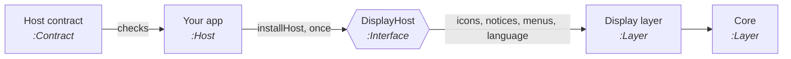

# Adding a host

A host is an app the editor is shown in: Obsidian, the browser editor from Claude Code and, later, the standalone app
and VS Code. The editor draws everything itself with the web page. A host gives only the few things that it alone
decides, through one interface, `DisplayHost`.

<!-- wiki:edition -->

## How it fits



1. Write an adapter: an object with the members below, made from your app's own icons, notices and menus.
2. Call `installHost(yourAdapter)` once, before anything is drawn.
3. Run the host contract against your adapter in your tests.

The interface is at contract version <!-- wiki:host-version -->. The version changes with every change to `DisplayHost`.

## What a host gives

Read from
[`packages/core/src/display/host.ts`](https://github.com/rogerbucks/thoughtknot/blob/main/packages/core/src/display/host.ts):

<!-- wiki:host-members -->

Obsidian's adapter is the shortest example:
[`packages/obsidian/src/display-host.ts`](https://github.com/rogerbucks/thoughtknot/blob/main/packages/obsidian/src/display-host.ts).
The browser editor's is
[`packages/claude-code/page/browser-host.ts`](https://github.com/rogerbucks/thoughtknot/blob/main/packages/claude-code/page/browser-host.ts).

## Check your host

`hostContract(make)` gives every check. `make` returns a fresh adapter and a probe, which lets the checks see the
notices and menus your app showed.

```js
import { hostContract } from '@thoughtknot/core/display/host-contract';

for (const check of hostContract(makeMyHost)) await check.run();
```

<!-- wiki:host-checks -->

## Rules a host follows

- **Colours.** Map your app's theme to the design tokens in one place. Your theme always wins. The tokens are listed on
  [Writing a plug-in](Writing-a-plug-in#colours-the-design-tokens).
- **Language and direction.** Give `language()`, and `direction()` if your app sets its own. The words and the mirroring
  follow with no other work.
- **Security.** If your app forbids inline styles, set `noInlineStyle`. The layer then sets styles a safe way.

## The requirements for hosts

<!-- wiki:section 10 -->
