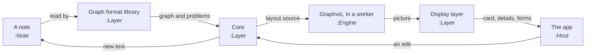

# Architecture

ThoughtKnot is built in layers. Each layer only uses the ones below it, so a new app can be added on top without
changing what is underneath.

<!-- wiki:edition -->

## The layers

The drawing is made from
[`requirements/architecture.gql`](https://github.com/rogerbucks/thoughtknot/blob/main/requirements/architecture.gql), a
graph note kept in the repository. Each box is a part, and each six-sided box is an interface between layers. A dashed
box is planned.

<!-- wiki:architecture -->

<!-- wiki:layers -->

## How the code is structured

Each part is cut into areas. An area is a set of files with one job and the spec section it serves. The graph note
names every area and its files. So a new file has to be placed in one. An area that grows past its ceiling has to be
split, or its ceiling raised on purpose.

An arrow says how many files of one area import the other. Two areas that import each other are listed under the
table: a split would have to untangle them first.

<!-- wiki:structure -->

## The interfaces

Every interface between layers has a contract: a set of checks that any app or plug-in runs against itself. If it
passes, it fits.

<!-- wiki:interfaces -->

## How a note becomes a drawing

1. The **graph format library** reads each `gql` block of the note and checks it against the rules.
2. The **core** works out what to draw, the problems and their fixes. It writes a layout source that is the same, byte
   for byte, in JavaScript and Python.
3. **Graphviz** lays the drawing out in a worker, so the page never freezes.
4. The **display layer** shows the card, the details and the forms, using only the web page.
5. The **app** gives the few things only it knows: icons, notices, menus, its language.
6. An edit goes back through the core, which writes the new text into the note. The note is always the one store.

## The rules between layers

<!-- wiki:section 10 -->

## The plug-ins, layers and contracts

<!-- wiki:section 43 -->

## Designs

- How ready the layers are for other languages, right-to-left scripts, plug-ins, themes and contract tests:
  [design review](Design-review).
- The whiteboard, a board for brainstorming with several people that decomposes into graph items:
  [whiteboard design](Whiteboard-design).
- Freehand ink, shapes and notes drawn on a graph, pinned to what they mark: [drawings design](Drawings-design).
- Graph notes in Microsoft 365 Copilot Cowork: [Copilot Cowork skill design](Copilot-Cowork-skill-design).
- An AI breaking prose into a graph shown as a proposal: [text to graph design](Text-to-graph-design).
- Claude showing a graph, walking you through it and taking your decision: [Claude presents and decides design](Claude-presents-and-decides-design).
- Who and what each part trusts, where that trust ends, and the gaps found: [trust model](Trust-model).
- Opening, drawing and moving around a graph of 2,000 to 50,000 things in close to real time, measured:
  [massive graphs design](Massive-graphs-design).
- Clusters a person writes or an algorithm finds, and the centroids that sum them up, on the big-graph groups engine:
  [clusters design](Clusters-design).
- Formatting by rule, intents that things support or contradict, and calculated values with totals:
  [rules, intents and calculated values design](Rules-intents-and-calculated-values-design).
