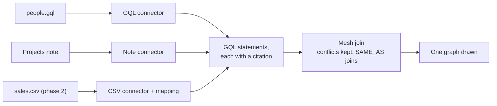
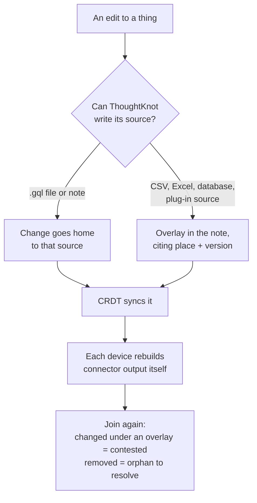

# Connectors design

Roger asked on 24 October 2026 for graphs made from many sources at once. This page is the design. The requirements
are editor spec section 63, workstreams CN1, CN2 and CN3.

## The short answer

A connector reads one place and gives GQL statements. Each statement says where it came from. A graph can list several
places. ThoughtKnot joins them with the mesh join, so nothing is lost and disagreements stay visible.

- **Phase 1 (CN1, Wave 13):** many GQL sources at once: .gql files, notes and plug-in sources.
- **Phase 2 (CN2, Wave 33):** text, CSV, Excel and SQLite files, each broken into GQL statements that cite back.
- **Phase 3 (CN3, Wave 13):** edits from many devices and AI authors, carried by the CRDT, across every connector.

````markdown
```gql
// graph: team · FROM Graphs/people.gql, [[Projects]], sample:trip
```
````



## Phase 1: many GQL sources

| Question | Answer |
| --- | --- |
| How do I write it? | List places after FROM, split by commas. Today FROM takes one place. |
| What places? | A .gql file, a note's gql blocks, or a plug-in's source. |
| Is anything copied? | No. Each place is read where it is written. |
| Two sources disagree? | The join holds it as contested. No source wins silently. |
| Same name in two sources? | One thing only inside one context, or through a SAME_AS link (section 61). |
| Does list order matter? | No. Any order draws the same graph. |
| Where did this come from? | Every thing, link and property cites its place, the text's hash and the line. The details panel shows it. AI answers carry it. |
| One source is missing? | The rest still draw. The drawing names the missing one and why. |

**One contract.** Every connector takes a place and gives statements, a citation on each, and a version. One contract
suite tests every connector. A new kind of source adds a connector. The join never changes.

## Phase 2: other files become GQL

| File | Broken into | Cites |
| --- | --- | --- |
| CSV | A statement per row, by the mapping | Row and column |
| Excel | A statement per row of a sheet, by the mapping | Sheet and cell |
| SQLite | A statement per row of a table, by the mapping | Table and row key |
| Text or prose | A proposal, as text to graph does | Line of the sentence |

- **The mapping is written down.** It says which columns become things, links and properties. It is proposed on the
  first read. A person applies it. It is never guessed again at each read.
- **The file stays the source.** Its statements are derived, rebuilt from the file and cached by its hash. The note
  keeps only the FROM line and the mapping. A snapshot is written only if you pick one (section 52).
- **On the device only.** No network and no other program. SQLite keeps the import's local-only rule.
- **Waits on section 52.** Phase 2 sits with data tables (E1), because Roger picks how outside data is linked there.

## Phase 3: updates through the CRDT

The CRDT (W30) carries what people and AI authors write. It never carries what a connector works out.



| Rule | Why |
| --- | --- |
| Sync only what is written | Connector output rebuilds the same on every device. Syncing it would double the traffic and the conflicts. |
| An edit goes home when it can | A .gql file or a note is text the CRDT already carries. |
| Read-only sources get an overlay | Export stays one way (section 38). The CSV is never changed. |
| A refresh joins again | A source that moved under an overlay is contested, never overwritten either way. |
| One edit across sources is one bundle | Undo takes it all back at once. |
| Every device agrees | Same source versions plus same merged edits draw the same graph. A convergence test proves it. |

## Built on

- The mesh join, SAME_AS identity and certainty (Wave 9).
- Contexts: where same names may join (section 61, CX1).
- FROM sources today (section 20, gql_file_source, plugin_source_from).
- The SQLite import, kept local (db_import_on_request).
- Data tables and cubes (section 52, E1).
- The CRDT and the local store (W30, W31). Storage of your choice (section 55, ST1).

## Still open

- Excel needs a reader. Picking one adds a runtime dependency, so it is Roger's call when phase 2 starts.
- Sources outside the vault: cache a copy the CRDT carries, or show them as missing on devices without them. Section 52
  decides this per source.
