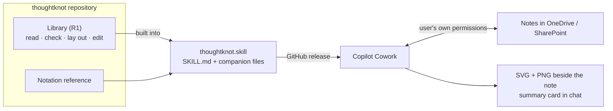

# Copilot Cowork skill design

A skill for Microsoft 365 Copilot Cowork that does the thoughtknot work there. It reads, checks, draws and edits the
graph blocks of Markdown notes kept in OneDrive or SharePoint. Designed on 18 October 2026, against version 0.5.0, at Roger's
request. Not built yet.

The requirements are section 46 of
[`requirements/editor-requirements.md`](https://github.com/rogerbucks/thoughtknot/blob/main/requirements/editor-requirements.md),
slice 10, in workstream M1. They are built in Wave 23 of
[`requirements/waves.json`](https://github.com/rogerbucks/thoughtknot/blob/main/requirements/waves.json), after the
Obsidian community release (R2) and the whiteboard. Roger's rule is that what he adds now goes after R2.

## What a Cowork skill is

Checked against Microsoft Learn on 18 October 2026
([Use Cowork](https://learn.microsoft.com/microsoft-365/copilot/cowork/use-cowork#cowork-skills),
[Build plugins](https://learn.microsoft.com/microsoft-365/copilot/cowork/cowork-plugin-development),
[Customize](https://learn.microsoft.com/microsoft-365/copilot/cowork/cowork-customize)).

| Fact | What it means for us |
|---|---|
| A skill is a `SKILL.md` (name, description, then instructions) in `OneDrive/Documents/Cowork/skills/<name>/` | The same format as a Claude skill, so one file serves both |
| Up to 20 companion files per skill (5 MB each, 10 MB in all), loaded on demand | Room for the built library and the notation reference |
| Uploaded as a `.md`, `.zip` or `.skill`; shareable inside an organisation; or packaged in a plugin with connectors | Ship a `.skill` with each GitHub release; no store listing needed |
| Cowork works with the user's own permissions and shows Microsoft 365 sensitivity labels | Notes are read where they live; our ceiling sits on top of the labels |
| Sensitive actions (writing, sending) wait for the user's approval | Fits our rule that every edit is a proposal first |
| Plugins import Claude plugin skills; commands, hooks and executables (`bin/`) are not supported | No Claude Code mod parts carry over: only the skill |
| Cowork scores each skill (structure, triggering, behaviour) when it is made or changed | A free outside check on the skill's description and steps |

## How it fits

- **One core, no second copy.** The skill's steps call the library from a companion script. Its prose tells Cowork
  when and how to use the script, never the notation's rules, so a rule changes in one place (`cowork_core_only`).
- **Host contract (L1).** Cowork is the host. File reads and writes go through Cowork's own OneDrive access. So the
  skill needs a storage backend that reads and writes the text handed to it. It has the same shape as the plain-folder
  backend in `storage_contract`. Display is files and a card, not a live pane.
- **Edits.** Same bytes as Obsidian, proved by the shared edit cases, and shown for approval before a file changes
  (`cowork_same_bytes`).
- **Safety.** The note's classification and the AI ceiling are checked before a note is read into the conversation,
  as `/graph edit` does in Claude Code (`cowork_ceiling`). No server, connector or secret of ours (`cowork_no_server`).
- **Release.** Built from the tag, attached to the GitHub release as `thoughtknot.skill` (`cowork_released`).

## Scripts

Cowork runs a skill's companion scripts (Roger, 18 October 2026), so the library runs inside Cowork as a script and
no connector is needed. A connector stays out unless a later security review approves one (`cowork_no_server`).

## Not in scope

Live editing in a pane, the whiteboard, sync and the mesh. Cowork on mobile, which does not run custom skills.
