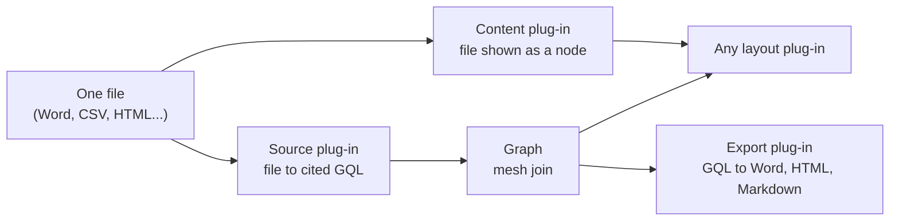

# Data formats design

Roger asked on 25 October 2026 that common data formats be part of the standard spec. This page is the plan. The
requirements are editor spec section 67, workstream DF1. Nothing here is built yet.

## The short answer

Every format is a set of plug-ins. No format touches the core.

| Plug-in | What it does | Example |
| --- | --- | --- |
| **Source** | Reads a file into GQL statements, each citing its place (section 63) | Word headings become things |
| **Content** | Draws a file as one node, in 2D and 3D: size, shape, painter | A CSV drawn as a table |
| **Layout** | Places things. Works for every format's graph (section 15) | Radial, layered, stress |
| **Export** | Composes GQL back out into a file (section 16) | Graph to Word or HTML |

## One file, several views

A file is not one thing. The same Word file can be:

1. **A graph.** Headings, people, dates and references become things and links.
2. **A content node.** Its text, drawn as a page.
3. **Both at once, side by side.** Both cite the same file hash. Turning one off never changes the other.

Same for a CSV: a table node, and a graph through its written mapping.

## Both ways

GQL also composes out: to Word, HTML, Markdown, slides or a table. Composing is an export. It is one-way
(export_one_way), says what it left out, and never changes the graph.

**HTML** is the one format we compose, decompose and display. Display is sandboxed: no script runs, nothing is fetched,
forms are inert. Display comes in a later wave than reading and composing.

## Formats and roles

Planned. S = source, C = content node, E = export, V = display.

| Format | S | C | E | V | Notes |
| --- | --- | --- | --- | --- | --- |
| Markdown | yes | yes | yes | yes | Text. Already how notes work. |
| Mermaid | yes | yes | yes | yes | Text. Flowchart and similar into things and links. |
| CSV | yes | table | yes | yes | Text. Needs a written mapping to be a graph. |
| JSON | yes | tree | yes | | Text. Objects to things, keys to properties. |
| GraphML, GEXF, DOT | yes | | yes | | Text. GraphML export exists today. |
| Cypher, GQL | yes | | yes | | Text. GQL is the home format. |
| OPML | yes | outline | yes | | Text. Outlines to trees. |
| SQLite | yes | table | | | Local file only (db_import_on_request). |
| Excel | yes | sheet | yes | yes | Needs a reader library. Roger's call. |
| Word | yes | page | yes | yes | Needs a reader library. Roger's call. |
| PowerPoint | yes | slide | yes | | Needs a reader library. Roger's call. |
| PDF | text and links | page | | yes | Needs a reader library. Roger's call. |
| Images | alt text and EXIF | picture | | yes | Pictures are shown, not read as graphs. |
| HTML | yes | page | yes | sandboxed | Display is future work. |

## Safety

- **Every file is untrusted.** Macros, scripts and embedded links are never run or fetched.
- **Limits.** Size and unpacking limits stop a zip bomb or a huge sheet.
- **Refused files are named.** Never a blank drawing, never silently partial.
- **Loss is stated.** Each read and write says what it could not keep.
- **Text formats first.** They need no new library. Office files and PDF each need one, and each is Roger's call.

## Built on

- Connectors: one contract for sources, the mesh join, citations and overlays (section 63).
- Data tables and cubes (section 52, E1).
- The plug-in interface and contract suites (section 43).
- Exports and the one-way rule (sections 16 and 38).
- Layout plug-ins (section 15, the layouts thread).

## Still open

- Which reader library for Excel, Word, PowerPoint and PDF. Each adds a runtime dependency.
- The wave for sandboxed HTML display, and the sandbox used in Obsidian.
