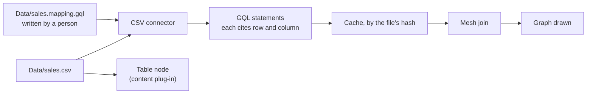

# Data tables design

Roger asked on 19 October 2026 that a graph can use tables and cubes of data, from outside sources too. This page
compares the ways to do it, so Roger can pick one. The requirements are editor spec section 52, workstream E1. They
sit with connectors part 2 (section 63, CN2) and data formats (section 67, DF1).

## The short answer

A data set stays a file. The graph names it and reads it through a connector. Nothing is copied into the note.

- **Named:** a short reference says where the data lives and which version was read.
- **Read, not copied:** a connector turns rows into things, by a mapping a person wrote and applied.
- **Linked or kept:** linked by default. A snapshot, a frozen copy beside the note, only when you pick one.
- **Cached:** what was read is cached by the file's hash, with its time, so the graph opens offline.
- **Cubes:** a table whose mapping marks some columns as dimensions and some as measures. Measures are the same as
  the calculated ones (section 57).



## What a note holds

````markdown
```gql
// graph: sales · FROM Data/sales.csv
```
````

The mapping sits beside the file, as graph data a person can read and change:

```gql
// graph: mapping
(sales:DataSet {place: 'Data/sales.csv', kept: 'linked'})
(sales)-[:ROW_IS]->(:Thing {kind: 'Order', key: 'order_id', name: 'order_id'})
(sales)-[:COLUMN]->(:Column {name: 'amount', as: 'measure', unit: 'GBP'})
(sales)-[:COLUMN]->(:Column {name: 'region', as: 'dimension'})
(sales)-[:COLUMN]->(:Column {name: 'customer', as: 'link', type: 'BOUGHT_BY', to: 'Customer'})
```

A pointer into the data set names the place, then a row, a column or a cell:

| Points at | Written as |
| --- | --- |
| The data set | `Data/sales.csv` |
| A row | `Data/sales.csv#row=12`, or by key `Data/sales.csv#order_id=A-1001` |
| A column or measure | `Data/sales.csv#col=amount` |
| A cell | `Data/sales.csv#row=12&col=amount` |
| A sheet's cell (later) | `Data/sales.xlsx#sheet=2025&cell=C12` |
| A table's row (SQLite) | `Data/shop.db#table=orders&key=1001` |

## The ways compared

| Way | How a graph refers to the data | Linked or kept | Cache | Fits the rules? |
| --- | --- | --- | --- | --- |
| **A. Copy in** | The rows are written into the note as GQL, as the SQLite import does today | Kept only | None needed | No: the note becomes the store (text_is_the_store). Big notes, merge conflicts. |
| **B. FROM plus mapping** | `FROM Data/sales.csv`, with a mapping file beside it | Linked; snapshot on request | By file hash | Yes. Uses the connector contract that exists. |
| **C. DataSet thing** | A `DataSet` thing in the graph names place, version and pointers | Either | By file hash | Yes. Gives the short named reference and cell pointers. |
| **D. Stored query** | A saved query (SQL, a cube query) run against the source | Linked | By query and source version | Partly: needs a query engine per source. Later, for SQLite. |
| **E. Table node only** | The file drawn as one node, never as things | Linked | By file hash | Yes, but gives no graph. Kept as a view of B. |

**Recommended: B and C together.** B reads the data; C names it, carries its version and lets anything point inside
it. A stays as the snapshot choice (data_set_linked_or_kept). D comes later for SQLite and cubes. E is the table node
every data set also gets (format_content_node).

## Linked, kept and cached

| Choice | What happens | When it reads again |
| --- | --- | --- |
| **Linked** (default) | The file is read where it is | When its hash changes, or you ask |
| **Snapshot** | A frozen copy saved beside the note, named with its date | Never, until you take a new one |
| **Outside the vault** (later) | Fetched only when you ask, from a place you picked, with the host's sign-in | When you ask |

- **The cache** holds the statements read, the file's hash, where it came from and when. The drawing shows the age.
- **Offline:** the cache draws. A missing file is named, with the age of what is shown (gql_file_missing).
- **No secrets in a note.** Sign-in stays with the host. A source above the note's classification is refused.

## Cubes

A cube is a table with roles on its columns. The mapping marks each column:

| Role | Meaning | Example |
| --- | --- | --- |
| `key` | Names the row's thing | `order_id` |
| `dimension` | A way to group | `region`, `month` |
| `measure` | A number to total | `amount` in GBP |
| `link` | A link to another thing | `customer` |
| `property` | Kept as a property | `note` |

Measures join the measure model the calculated values use (calc_measures_shared). So filter totals, the table view and
charts add them up with the same code.

## Safety

- **Every file is untrusted** (format_untrusted_files). Size, row and column limits. A refused file is named.
- **On the device only** (connector_files_on_device). No network, no other program.
- **A person applies the mapping** (connector_mapping_written). The first read proposes one; it is never guessed again.

## Order of work

1. CSV: reader, mapping proposed and applied, statements citing row and column, cache by hash.
2. The data set reference and pointers; snapshot on request.
3. The table node in 2D and 3D.
4. Cubes: dimensions and measures in filter totals and the table view.
5. SQLite tables through the same connector. Text as a proposal. Excel later, with a reader library (Roger, D1).

## Decision

**Picked: B and C together** (Roger, 6 Nov 2026).

- **B reads the data.** A graph says `FROM Data/sales.csv`, and the mapping file beside it says what each column becomes.
- **C names it.** A `DataSet` thing names the place and its version. It lets anything point inside it, such as
  `Data/sales.csv#row=12&col=amount`.
- The data is linked by default. A snapshot (A) is taken only when a person asks for one.
- E, the table node, is how a data set is drawn as itself. D waits for SQLite and cubes.

## Built on

- [Connectors design](Connectors-design): one contract, the mesh join, citations.
- [Data formats design](Data-formats-design): source, content, layout and export plug-ins.
- The SQLite import, kept local (db_import_on_request).
- Measures shared with calculated values (section 57, CV1).
