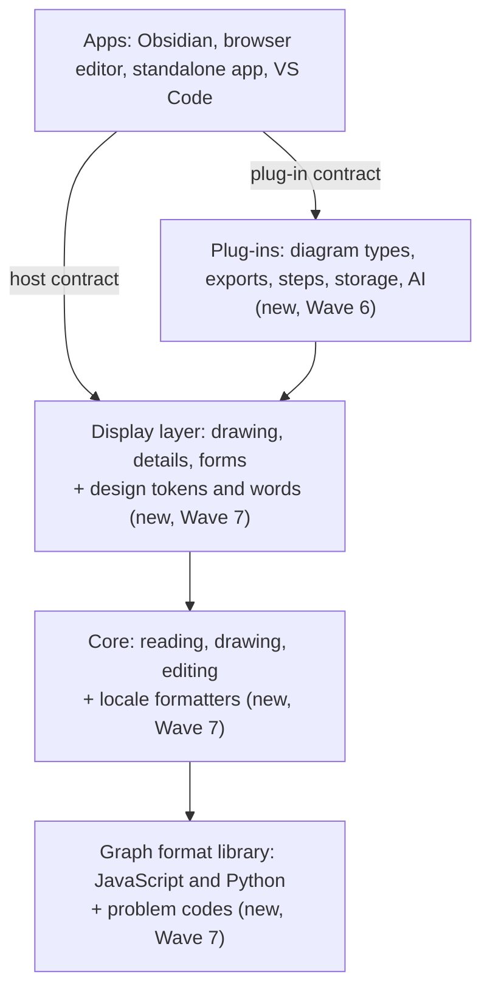

# Design review: language, plug-ins, theming and tests

A solution architect's review of how ready ThoughtKnot is for the things users will ask for. These are other languages
and cultures, right-to-left scripts, plug-ins, themes, and tests that check each layer and run only what a change
touches.
It says what is there today, where the code already has a place to fit each one, and the design to build. Reviewed on
17 October 2026, against version 0.5.0.

The requirements it adds are in
[`requirements/editor-requirements.md`](https://github.com/rogerbucks/thoughtknot/blob/main/requirements/editor-requirements.md),
sections 42 to 44, and the order they are built in is in
[`requirements/waves.json`](https://github.com/rogerbucks/thoughtknot/blob/main/requirements/waves.json).

## The short answer

| Ask | Ready today | Cost to add now | Cost if left until after the new apps |
|---|---|---|---|
| Tests run only for what changed | Partly. Now fixed (see below) | Done in this change | — |
| Layer and host contract tests | Partly: two boundary tests, one host contract planned | Small | Grows with every new app |
| Plug-in interface | No: every extension point is a closed list | Medium | High: each app would wire its own |
| Theming that plug-ins inherit | Partly: follows the host's light and dark theme | Small | Medium |
| Language (translation) | No: at least 230 English texts written in the code | Medium | High: every new app adds more |
| Culture (numbers, dates, sorting) | No: fixed to UK English in 5 places | Small | Small |
| Right-to-left | No: 25 style rules are left or right only | Medium | High |

**Recommendation:** build the contracts and the plug-in interface in Wave 6, with the host and storage contracts already
planned there. Then build language, theming and right-to-left in Wave 7, before the standalone app and VS Code.
Each new app then gets them for free instead of being retrofitted.

## How the layers fit



Each arrow is an interface with its own contract test suite. Every app runs the same suite against its real adapter,
and every plug-in runs its extension point's suite against itself.

## 1. Tests that run only for what changed

**Today.** `npm run test:changed` picked tests by name only: `zoom.ts` ran `zoom*.test.js`. A module with no test named
after it, a package's entry, a page module or shared test support ran the whole suite. That was 179 of 302 source
modules, so most changes ran all of it.

**Done in this change.** The quick run now also follows the import graph
([`scripts/import-graph.mjs`](https://github.com/rogerbucks/thoughtknot/blob/main/scripts/import-graph.mjs)). Every test
runs that imports a changed file, directly or through other modules, or names it to build or walk. The whole suite now
runs for only 6 modules, and a typical change runs about 39 test files out of 435. The full suite still runs before
every merge and in CI.

**Next.** Contract tests (below) import the interface they prove, so changing an interface automatically runs every
adapter's and plug-in's contract suite.

## 2. Layer interface and contract tests ("target interface tests")

**Today.**
- The display layer's host interface is `DisplayHost`
  ([`packages/core/src/display/host.ts:23`](https://github.com/rogerbucks/thoughtknot/blob/main/packages/core/src/display/host.ts#L23)):
  icon, phone test, notice, menu and the style policy.
- Two adapters implement it: Obsidian's
  ([`packages/obsidian/src/display-host.ts:8`](https://github.com/rogerbucks/thoughtknot/blob/main/packages/obsidian/src/display-host.ts#L8))
  and the browser page's
  ([`packages/claude-code/page/browser-host.ts:87`](https://github.com/rogerbucks/thoughtknot/blob/main/packages/claude-code/page/browser-host.ts#L87)).
  Each is tested on its own; no one suite proves both behave the same.
- Boundary checks exist for parts of the stack: `packages/core/test/imports.test.js` and `hosts-boundary.test.js`.
- `host_contract_published` and `storage_contract` (Wave 6) already plan one shared suite each.

**Design.**
- One contract suite per interface, written as a function that takes an adapter:
  `hostContract(makeHost)`, `storageContract(makeStore)`, `pluginContract(point, plugin)`. Each lives beside its
  interface in the core and is exported, so anyone building an app or plug-in can run it.
- Every real adapter runs it in CI (`hosts_pass_contract`): Obsidian's against its test shim, the browser page's in a
  DOM, and the app and VS Code when they arrive.
- One layer check (`layers_checked`) replaces the scattered ones. Each layer imports only the layers below it. The check
  reads the same import graph the quick test run uses.

## 3. Plug-in interface

**Today.** Every extension point is a closed list in the code:
- Diagram types: `DIAGRAM_TYPES`
  ([`packages/core/src/style-graph.ts:49`](https://github.com/rogerbucks/thoughtknot/blob/main/packages/core/src/style-graph.ts#L49)).
- Data exports: `DATA_FORMATS` and an if-chain
  ([`packages/core/src/export-data.ts:16`](https://github.com/rogerbucks/thoughtknot/blob/main/packages/core/src/export-data.ts#L16),
  [`:82`](https://github.com/rogerbucks/thoughtknot/blob/main/packages/core/src/export-data.ts#L82)).
- Graph steps and sources, AI providers and storage have the same shape.

**Design.** One small registry in the core (`plugin_interface`):

```ts
interface ThoughtKnotPlugin {
  id: string;            // 'acme.mermaid-export'
  version: string;       // semver
  api: '1';              // the plug-in interface version it was built for
  uses: Capability[];    // what it may touch, from its manifest (plugin_manifest_limits)
  register(points: ExtensionPoints): void;
}
// points.diagramTypes.add(...), points.exports.add(...), points.steps.add(...),
// points.storage.add(...), points.ai.add(...), points.commands.add(...), points.theme.add(...)
```

- The built-in diagram types and exports move behind it first, so the interface is proved by real use before anyone
  else relies on it.
- A plug-in gets only the capabilities its manifest lists. One that throws or runs too long is stopped and named. The
  drawing then falls back to text, as a layout that is too large does today.
- Plug-ins are versioned with the library (`lib_public_api`), so a breaking change needs a new major version.
- Obsidian plug-ins and VS Code extensions keep working as they are; this is ThoughtKnot's own interface inside them.

## 4. Theming, inherited by plug-ins

**Today.** The drawing follows the host: one colour map per host
([`packages/core/src/palette.ts:1`](https://github.com/rogerbucks/thoughtknot/blob/main/packages/core/src/palette.ts#L1)),
light and dark, at the locked contrast. The interface's style sheet uses Obsidian's own variables directly (321 uses in
`styles.css`); the browser page copies them. Drawing themes as a graph (`theme_graph`) are planned for slice 8.

**Design.**
- One set of named design tokens, `--gn-*`, for colour, type, spacing, corners and motion (`ui_theme_tokens`). Each
  host maps its own theme to them in one table, as the colour map does for the drawing. Every rule in the style sheets
  uses only tokens.
- A plug-in inherits every token. It may add its own for the items it adds, each with a light and a dark value
  (`plugin_theme_tokens`, through `points.theme.add`). CI checks each against the locked contrast.
- Later, `theme_graph` sets the same tokens from a graph, so a theme written as a note restyles the app too.

## 5. Language (translation)

**Today.** At least 230 user-facing texts are written inline in the code (notices, labels, settings, problems), across
the core, the display layer and both hosts. The page says `lang="en"`
([`packages/claude-code/page/index.html:2`](https://github.com/rogerbucks/thoughtknot/blob/main/packages/claude-code/page/index.html#L2)).
Problems carry free text only
([`packages/core/src/note-reading.ts:107`](https://github.com/rogerbucks/thoughtknot/blob/main/packages/core/src/note-reading.ts#L107)).

**Best place to start.** `refusal-words.ts`
([`packages/core/src/hosts/refusal-words.ts`](https://github.com/rogerbucks/thoughtknot/blob/main/packages/core/src/hosts/refusal-words.ts))
already keeps the reason as data and the words apart. That pattern scales.

**Design.**
- One catalogue of words by key, UK English as the source (`words_catalogue`), with placeholders and plural forms
  (`Intl.PluralRules`). A lint fails CI on user-facing text written outside it.
- The host tells the display layer its language (`language_follows_host`): add `language()` to `DisplayHost`. Obsidian
  reads its own language, the browser page and the app the system's, VS Code its display language. A missing word
  falls back to English, never to its key.
- Every problem gets a stable code, as the Language Server Protocol already allows (`problem_codes`), the same from
  the JavaScript and the Python libraries. The message is looked up by code, and people can search for it.
- Translations are plain files per language, checked for the same keys and placeholders (`translations_as_files`).
- The plain-language check (`ux_copy_auto`) keeps running on the source language.

## 6. Culture (numbers, dates, sorting)

**Today.** Fixed to UK English in five places:
[`refusal-words.ts:7`](https://github.com/rogerbucks/thoughtknot/blob/main/packages/core/src/hosts/refusal-words.ts#L7),
[`steps.ts:100`](https://github.com/rogerbucks/thoughtknot/blob/main/packages/core/src/steps.ts#L100),
[`steps.ts:218`](https://github.com/rogerbucks/thoughtknot/blob/main/packages/core/src/steps.ts#L218),
[`github-review-items.ts:174`](https://github.com/rogerbucks/thoughtknot/blob/main/packages/core/src/github-review-items.ts#L174)
and the Claude Code
[`graph-view.ts:33`](https://github.com/rogerbucks/thoughtknot/blob/main/packages/claude-code/src/graph-view.ts#L33).

**Design.**
- One small formatter module in the core (`locale_formats`) for counts, sizes, dates, times, lists and sorting. It is
  built on the browser's own `Intl`, with the locale and time zone from the host.
- What is written to a note never changes with locale (`locale_never_changes_bytes`): ISO dates and a full stop for
  decimals. This protects the byte-for-byte promises the editor already makes (`round_trips`, `layout_byte_identical`).

## 7. Right-to-left

**Today.**
- 25 style rules use left or right
  ([`styles.css`](https://github.com/rogerbucks/thoughtknot/blob/main/styles.css), lines 374 to 1463, and 6 in
  `packages/claude-code/page/page.css`); 11 already use logical properties.
- The arrow keys move by screen direction
  ([`packages/core/src/untangle.ts:228`](https://github.com/rogerbucks/thoughtknot/blob/main/packages/core/src/untangle.ts#L228)).
- Menus and sheets are placed by left offset (`browser-host.ts` menu, `--thoughtknot-sheet-left`).
- Drawings run left to right or top to bottom only
  ([`packages/core/src/layout.ts:24`](https://github.com/rogerbucks/thoughtknot/blob/main/packages/core/src/layout.ts#L24)).

**Design.**
- The host tells the layer its direction; the layer sets `dir` on its root, and everything follows.
- Style sheets use logical properties only (`margin-inline-start`, `inset-inline-end`), checked by a lint
  (`rtl_mirrors`).
- The arrow keys follow reading direction.
- Labels and values are isolated (`dir="auto"`, `unicode-bidi: isolate`) so Arabic or Hebrew names show correctly in a
  left-to-right interface and the other way round (`bidi_labels`). Box widths are measured for the script.
- A right-to-left drawing is offered (`rtl_drawing_direction`). Graphviz lays out left to right; the drawing is
  mirrored after layout, so the layout source stays byte for byte the same.

**Checked automatically.** CI runs every view in a long, accented pseudo-locale and a right-to-left one. It fails on
clipped text, untranslated words or controls on the wrong side (`pseudo_locales_checked`). This fits the existing
WCAG, keyboard and visual-regression checks (`a11y_*_auto`, `visual_regression_auto`), so nobody checks by hand.

## 8. Other standard interface needs

Checked against WCAG 2.2, Apple's and Microsoft's design guidance and common design-system practice.

| Need | Covered today | Added |
|---|---|---|
| Light and dark themes | Yes (`contrast_both_themes`, `cc_theme_follows`) | — |
| Contrast | Yes (`contrast_both_themes`, `wcag_checked`) | — |
| Reduced motion | Yes (`motion_reduced_respected`, `cc_reduced_motion`) | — |
| Keyboard and focus | Yes (`keyboard_reach`, `a11y_keyboard_auto`, `focus_readable`) | — |
| Screen readers | Yes (`a11y_semantics_auto`, `problems_announced`) | — |
| Touch targets | Yes (`touch_targets`, `a11y_targets_reflow_auto`) | — |
| Narrow screens and reflow | Yes (`a11y_targets_reflow_auto`) | — |
| Empty states | Yes (`empty_view`, `empty_export`, `empty_block_start`) | — |
| Undo | Yes (`undo_everything` and others) | — |
| Plain-language messages | Yes (`ux_copy_auto`) | — |
| Theme tokens for the interface | Yes. The interface's built 20 Oct 2026; a plug-in's own tokens reach the page in Obsidian and the browser page, 22 Oct 2026 | `ui_theme_tokens`, `plugin_theme_tokens` |
| High contrast and forced colours | Yes | `forced_colours` |
| Text enlarged to 200 per cent | Yes | `text_scaling` |
| Colour never the only signal | Yes, built 20 Oct 2026 | `colour_never_alone` |
| Progress for long waits | Yes, built 20 Oct 2026 | `progress_shown` |
| First-run help | Yes, built 20 Oct 2026 | `first_run_help` |
| Keyboard shortcuts listed | Yes, built 20 Oct 2026 | `shortcuts_listed` |
| Printing | Yes, built 20 Oct 2026 | `print_ready` |

## The build order

| Pull request | What it does | Wave |
|---|---|---|
| This one | This review, the requirements, and tests picked by the import graph | now |
| Contracts | One host contract suite run by both real adapters, and the one layer check | 6 |
| Plug-ins | The registry, with the built-in diagram types and exports moved behind it | 6 |
| Words and formats | The catalogue, problem codes, `language()` on the host, the locale formatters | 7 |
| Tokens | The `--gn-*` tokens, each host's map, plug-in tokens, forced colours and text scaling | 7 |
| Right-to-left | Logical properties and their lint, direction from the host, isolated labels, the pseudo-locale run | 7 |

Each one is test first, as every change here is, and small enough to review on its own.
