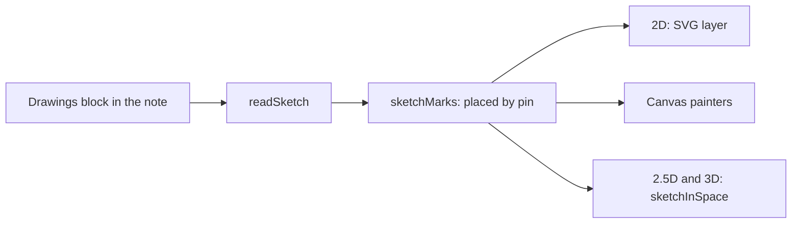

# Drawings design

Roger asked on 27 October 2026 (#1450) for a way to draw on a graph. That means circling a cluster, pointing at a
gap, or jotting a note while thinking. This page is the plan. The requirements are editor spec section 70, workstream DR1.

## The short answer

- **Draw on any graph:** freehand ink, a box, an ellipse, a line, an arrow or a short note.
- **Kept as text in the note**, in a drawings block of its own beside the graph: `// graph: trip_ink · SKETCH ON trip`.
- **Pinned or free.** A drawing pinned to a thing or a group moves with it. One with no pin stays at its spot.
- **One code path for every view.** Each drawing becomes the shared drawing marks. 2D, 2.5D and 3D draw those marks.
- **One switch** shows or hides them all.

## How a drawing is written

Each drawing is an item of the board's kinds, so the whiteboard and the drawings share one reader (`board.ts`).

| Kind  | What it is                         | Its own properties                         |
| ----- | ---------------------------------- | ------------------------------------------ |
| Ink   | a freehand stroke                  | `points: '0 0 12 4 30 9'`, pairs of numbers |
| Shape | a box or ellipse, a line or arrow  | `shape`, and `w` and `h` or `points`       |
| Text  | a short note                       | `text`                                     |

Every kind may have `pin`, the thing or group it is pinned to, and `style`, a hue such as `red`. A graph holds no lists,
so points are written as one text of numbers.

## How a drawing follows the layout

- **Pinned:** its `x` and `y` are an offset from the centre of what it is pinned to. A relayout moves it with that thing.
- **Wraps:** a box or ellipse pinned with no size of its own wraps what it is pinned to, a little way off. So "circle
  this cluster" still fits after the cluster grows.
- **Not shown:** pinned to a thing the view leaves out, it is not drawn there, never drawn at a wrong place.
- **Gone:** pinned to a thing the graph no longer holds, it is a problem with its fix (GN906).
- **Free:** with no pin, its place is a spot on the drawing.

## Every view

- **2D:** `sketchSvg` lays the drawings over the drawing as one layer, each part tagged so a tap can find it.
- **Canvas painters:** the drawings are ordinary marks (lines, boxes, labels, arrowheads), so they need nothing new.
- **2.5D and 3D:** `sketchInSpace` lays each drawing flat on the top of the block it is pinned to, or on the ground.

## The open questions, answered

1. **Pen only, or shapes and notes too?** All three in the first slice: once drawings are marks, each costs little.
2. **How does a stroke follow a thing?** By its pin, as above.
3. **Several people editing at once?** Not yet. Drawings change through the note's text, as everything else does. The
   whiteboard's shared editing comes later and will carry these too.

## Built so far

| Step | What                                                                 | Status      |
| ---- | -------------------------------------------------------------------- | ----------- |
| 1    | Spec, the drawings block, its checks, marks for every view           | this change |
| 2    | The Draw tool on the card, the show and hide switch, the click rule  | next        |
| 3    | The reader picture and exports, keyboard drawing, turn into things   | after       |
