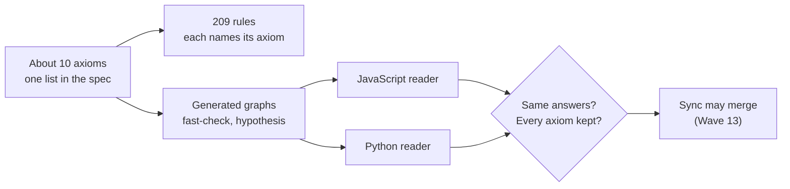

# Graph axioms design

Roger asked on 24 October 2026 for a job on axioms for the graph and the graph spec. This page is the design. The
requirements are editor spec section 64, workstream GS8.

## The short answer

An axiom is a law every valid graph obeys. The graph spec has 209 rules, but most of them follow from about ten laws.
Today those laws are spread across §10, §11, §12, §17, §20 and §21, and they are tested on hand-made examples only.

GS8 does three things:

1. **Writes the axioms down** in one short list in the graph spec: one plain sentence and one formal line each.
2. **Ties every rule to its axiom**, so a reader sees which few laws the rest rest on.
3. **Checks each axiom on thousands of generated graphs**, in both readers, so a break is found even where no example
   looked.

## The axioms (first draft)

| # | Axiom | In plain words | Formal line | Rests on |
|---|---|---|---|---|
| A1 | Identity | Each thing has one id, unique in its graph | `id` is injective on things of a graph | §10 |
| A2 | Links have two ends | Every link starts and ends at a thing that exists | `∀ l: from(l) ∈ T ∧ to(l) ∈ T` | §17 c-refs |
| A3 | Declared types | Every element has a type its schema declares | `∀ e: type(e) ∈ schema(g)` | §5, §17 c-types |
| A4 | Same text, same graph | Reading is a function, and writing then reading changes nothing | `read(write(g)) = g`; rebuild keeps ids | §10, §17 c-reload, c-rebuild |
| A5 | SAME_AS is an equivalence | A thing is the same as itself; same-as goes both ways and chains | reflexive, symmetric, transitive | editor spec §27, §61 |
| A6 | Joins are order-free | Join in any order, or twice, and get the same graph; nothing lost or invented | commutative, associative, idempotent | §21 |
| A7 | Certainty in range | A likelihood stays inside its declared band; derived ranges recompute | `0 ≤ low ≤ high ≤ 1` | §20 |
| A8 | History is a chain | An item has at most one successor, with no loops; the archive never changes | supersession is a forest | §12 |
| A9 | Derived equals recompute | Every cache, snapshot and derived element equals a fresh recompute from source | `derive(source(g)) = derived(g)` | §11, §17 c-caches |
| A10 | Conflicts are kept | A real clash becomes contested claims; neither side is asserted | `¬(assert p ∧ assert ¬p)` | §21 contested |

The list is a draft. GS8 settles it with Roger before it goes into the graph spec.

## Why before sync (Wave 13)

Wave 13 brings the CRDT transport (`crdt_transport`). A CRDT is correct only if its merge is order-free, idempotent and
loses nothing. That is axiom A6, with A5 for identity across devices. Today the join is tested on fixed cases. Checking
A5 and A6 on generated graphs first means sync is built on a proved merge, not a hopeful one.

The connectors planned for the same wave (CN1 and CN3: one graph from many sources, updates through the CRDT) rest on
the same two axioms.

## What it does not do

- It does not prove the whole app. It proves the format's laws hold, as the 19 October spec review advised.
- It does not stop a broken graph being read or drawn. A broken axiom is reported with a fix, like a completeness gap.
- It does not replace GS3 (grammar, canonical form). It feeds it: the canonical form must keep A4.

## Related

- Graph spec review, 19 October 2026: options 2 (property tests), 3 (both readers agree), 5 to 7 (solver, model,
  mutation).
- Workstreams GS1 (rules checked in CI, done) and GS2, GS3, GS5 to GS7 (held, Waves 30 to 32).
