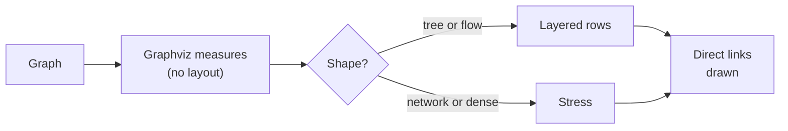

# Layout engine design

Roger asked on 25 October 2026 for our own layout engine. A graph of 329 things had been shown as text, because
Graphviz took longer than five seconds. This page is the plan. The requirements are editor spec section 68,
workstreams LE1, LE2 and PJ1. The first slice is built: section 53, layout_own_engine, behind the View switch
**New layout engine (preview)**.

## The short answer

Graphviz still measures each box and writes its words. Our engine places the boxes.

| Step | What it does | Where |
| --- | --- | --- |
| **Measure** | Graphviz sizes every box, placing nothing (its `nop` engine) | `layouts/own-draw.ts` |
| **Pick** | Rows for a flow or a tree, stress for a network or a dense graph | `layouts/own-engine.ts` |
| **Place** | Layered rows, or stress by gradient steps | `layouts/layered.ts`, `layouts/stress.ts` |
| **Draw** | Boxes moved to their spots, links drawn straight | `direct-links.ts` |

## First results

On Roger's real notes, in the cloud:

| Note | Things | Graphviz | Our engine |
| --- | --- | --- | --- |
| Graph spec requirements | 329 | 1.1 s, 8.5k by 44k px | 0.8 s, 6k by 8.5k px |
| Graph note editor requirements | 828 | 4.2 s, 41k by 125k px | 3.3 s, 9.5k by 17.7k px |
| GQL file type research | 131 | 2.7 s, 33k by 17k px | 0.5 s, 4k by 4.9k px |

No box sits on another. Long rows wrap, so a shallow graph is not one long strip.

## The phases

1. **LE1: never text, groups as boxes, strategies.** A slow Graphviz layout falls back to our engine, then to
   cheaper steps. Groups are boxes round their things, not Graphviz clusters. Each strategy has named variables.
   The 329 and 828 thing notes become fixtures with time limits. Once it is as good, our engine is the default and
   Graphviz is the "routed curves" strategy.
2. **LE2: the live loop.** A first picture in 0.1 s, readable in 1 s, settled in 5 s. Things glide from as-is to
   to-be, aligned so the drawing never spins. A view is six layers: dimensions, filters, strategy, projection,
   formatting, painter.
3. **PJ1: projections, all on.** Each projection is in the View menu, in 2D and 3D where it has a 3D form. A lens
   bends whatever a view drew round a focus, so one lens works on every view. The lenses are fisheye (built),
   semantic zoom (built), hyperbolic (built), sphere (built) and spatial (built).
   - **Spatial.** The view in space, in a headset where the device has one.
   - **Placements.** A placement is a view of its own: arc, matrix, hive, grid (kanban) and map (no tiles fetched), all
     built.
   - **Kanban drag.** A card dragged to another grid column has its status written in the text.
4. **Every view answers clicks.** A view is the card's own drawing, not a still picture. A thing in any view is chosen
   and opened as in a network.
5. **Semantic zoom** steps the ladder of detail as a person zooms. It counts the things that fit on screen at the zoom.
   Over 80, each group is a box with its count. Over 25, the things show with their links bundled. Then every link
   shows apart, and at 12 or fewer every property too. It steps only the way the person zoomed, a quarter past each edge.

## Links

Our engine draws its links through lanes it keeps between the boxes (`layouts/routed-curve.ts`). A drawing Graphviz
lays out has its links routed by our own router (`layouts/rows-route.ts`, #1232). Graphviz lays the links out
straight, so it routes nothing.

Past 300 things, each link then runs through a gap in each row it crosses, and bends
as one smooth curve between rows. Curved links a person chose are routed this way at any size. They are drawn at once.
No box moves, and no link runs over a box. The Python library routes them the same way.

## Plug-ins

Layouts, content and sources each have one contract (layout_contract, format_plugin_contracts, connectors). A new
layout works for every format, every projection and both 2D and 3D.
