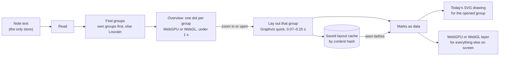

# Massive graphs design

This note covers how to open, draw and move around a graph of 2,000 to 50,000 things. The goal is close to real
time, on the person's own machine. This is the research note that section 53 asks for (`scale_design`). It was written on 22 October 2026, at
Roger's request, before any of section 53 is built. Roger pulled the section forward, ahead of R2, the same day.

Every number here was measured, not guessed. The scripts are kept in the project's shared files
(`massive-graphs/`), so anyone can run them again.

## The short answer

| Question | Answer |
|---|---|
| Why is a big graph slow today? | Two steps. Graphviz lays out every thing at once, and the browser draws every box as SVG. Both slow down faster than the graph grows |
| What is the fix? | Show groups first, and lay out the inside of a group only when you open it or zoom in. Draw the overview on the graphics chip (WebGPU, else WebGL). Save each finished layout so it opens at once next time |
| How fast? | 50,000 things: the overview in under a second. Opening a group takes 0.07 to 0.25 seconds. Panning costs under 1 millisecond a frame |
| What stays the same? | Graphs of up to 2,000 things keep today's drawing, with every feature. An opened group is drawn the same way, as a normal drawing |
| Recommended | Way E below: groups first, detail on demand, a saved-layout cache, and the graphics chip (WebGPU or WebGL) for the overview. It reads the marks every diagram type now gives as data |

## What was measured

The test graphs are a tree with random parents plus 30% extra cross links, like a real knowledge graph. Each thing
has a few words of text. Times are on one desktop core (Linux, Node 22, headless Chromium). A phone is about three
times slower. Drawing used Chromium's software graphics, so a real graphics chip is faster still.

### Laying a graph out

| Way to lay out | 2,000 things | 10,000 things | 50,000 things |
|---|---|---|---|
| Graphviz `dot`, full (before PR #922) | about 48 s a direction | not tried | not tried |
| Graphviz `dot`, quick settings (PR #922, merged) | 1.8 s | 59 s | out of reach |
| Graphviz `sfdp` (force layout) | over 2 min | over 2 min | out of reach |
| ELK layered (JavaScript) | 5.9 s | 88 s, 1 GB of memory | out of reach |
| d3-force, 300 steps | 3.8 s | 32 s | out of reach |
| ForceAtlas2, 100 steps | 1.1 s | 7.8 s | about 40 s, estimated |
| **Groups first** (find groups, lay out the groups, then one group's inside) | **0.1 s** | **0.2 s** | **0.8 s** |

Groups were found with the Louvain method, which links things that link to each other most. At 50,000 things it
found 130 groups in 0.65 seconds. The groups themselves laid out in 0.15 seconds. The inside of the largest group,
842 things, laid out in 0.25 seconds with Graphviz's quick settings. A median group, 364 things, took 0.07 seconds.

So no single layout of every thing is fast enough. Laying out a little at a time is.

### Drawing and panning

The time one frame of panning takes. Under 16 milliseconds is smooth, at 60 frames a second.

| Way to draw | 2,000 things | 10,000 things | 50,000 things |
|---|---|---|---|
| SVG, today's drawing | 8.5 ms, with stalls of 140 ms | 600 ms: stuck | not tried |
| Canvas, everything | 0.9 ms | 4.2 ms | 59 ms, with stalls of seconds |
| Canvas, only what is on screen (spatial index) | not needed | 1.3 ms | 1.5 ms |
| WebGL (graphics chip) | 0.5 ms | 0.5 ms | 0.5 ms |

The spatial index (Flatbush) finds what is on screen in well under a millisecond, at any size.

### Opening again

A saved layout of 50,000 things is 0.4 MB as numbers, or 0.8 MB as JSON. It loads in 0.15 ms as numbers and 19 ms as
JSON. So a graph seen before can open without any layout at all.

### Today's code, measured by the scale benchmark

The scale benchmark (`npm run bench:scale`, `scripts/scale-benchmark.mjs`) runs each step the way the hosts run it
today. It grows the V-10 graph of 2,666 things up to 100 copies. CI runs it on every pull request, and a step over its
budget fails the run. These are its numbers on one desktop core, on 22 October 2026. The 2× row was added on 23 October 2026, when the read limit was raised.

| Size | Open | Draw | Group | Overview | Pan | Edit |
|---|---|---|---|---|---|---|
| 1× (2,666 things, 0.4 MB) | read in 0.4 s | refused, shown as text | 20 groups, 0.006 s | 92 marks, 0.005 s | 0.3 ms a frame | 0.7 s |
| 2× (5,332 things, 0.8 MB) | read in 0.4 s | refused, shown as text | 64 groups, 0.02 s | 306 marks, 0.002 s | 0.4 ms a frame | 1 s |
| 10× (26,660 things, 4.2 MB) | refused over the read limit, 0.03 s | nothing to draw | 288 groups, 0.13 s | 1,554 marks, 0.008 s | 1.5 ms a frame | refused, 0.3 s |
| 100× (266,600 things, 43 MB) | refused over the read limit, 0.3 s | nothing to draw | 2,875 groups, 1 s | 15,660 marks, 0.06 s | 14 ms a frame | refused, 3.7 s |

Group finds the groups a graph opens as (way E, step 2). Past the read limit it runs on copies of the V-10 drawing,
made without reading. Overview turns the groups into marks, with an index of where they are (way E, step 4). Pan is
the slowest of 61 frames: the marks on a screen of 1600 by 1000 pixels, the first frame showing the whole overview. Three more things it shows:

- **The reader is slow too.** Reading 0.4 MB takes 0.4 seconds. So reading 100 copies whole would take about 40
  seconds, before any layout. Way E needs a faster reader, and way F reads only a part.
- **A refusal reads every byte first.** Refusing 43 MB takes 0.3 seconds. It could stop at the limit.
- **An edit past the limit gives the wrong reason.** It says to move the thing to a line of its own. The real reason is
  the size, and it takes 3.7 seconds to say so.

### The limits, before and after (way E, step 6)

On 23 October 2026 step 6 raised the read limits, so 2× V-10 opens. The drawing limit stays. Past it, the overview of
groups takes over (step 4). A bigger drawing limit would only make the slow layout slower.

| Limit | Before | After | Where |
|---|---|---|---|
| Read limit, text | 512 kB | 1 MB | `READ_LIMITS.bytes`, `packages/core/src/layout-limits.ts` |
| Read limit, lines | 10,000 lines | 20,000 lines | `READ_LIMITS.lines`, the same file |
| Drawing limit, things | 2,000 things | 2,000 things | `LAYOUT_LIMITS.things`, the same file |
| Drawing limit, links | 5,000 links | 5,000 links | `LAYOUT_LIMITS.links`, the same file |
| Library block limit | 1,000,000 characters | 1,000,000 characters | `block_chars`, `packages/graph-spec/src/reader/limits.js` |

- **Why 1 MB.** The library already refuses a block over 1,000,000 characters (a Wave 6 security limit). So 1 MB is
  the most the core can read without changing the library and the Python reader too.
- **What it costs.** 2× V-10 reads in about 0.4 to 0.7 seconds on one desktop core, and an edit takes about 1 second.
- **Hostile graphs.** A graph past the new limit is still refused before it is read, with the limit it is over. The
  test `test/massive-graphs-limits.test.js` holds this.
- **10× and more** stay refused. They wait for step 7, reading in parts.

## The ways compared

| Way | What it is | Speed at 50,000 | Keeps today's features | Work | Risk |
|---|---|---|---|---|---|
| A. Faster Graphviz | Tune settings, one direction (done in PR #922, merged) | Out of reach | All | Done | Tops out near 2,000 |
| B. Draw only what is on screen | Spatial index plus Canvas. Layout is still all at once | Drawing fine; layout still takes minutes | Few: no SVG to tap or style | M | Layout stays the bottleneck |
| C. Force layout in a worker | ForceAtlas2 in the background, the drawing settling as it runs | 40 s to settle | Few; the look changes from rows to a cloud | M | Loses the ordered, readable look |
| D. Graphics chip for all | WebGL for every size | Drawing fine; layout still slow | Needs rebuilding: taps, focus, marks, exports | L | Rebuilds what works today |
| **E. Groups first, detail on demand** | Groups found or named, an overview of groups, a group's inside laid out when opened. Saved layouts. Overview on the graphics chip | **Under 1 s, then 0.25 s a group** | **All, inside an opened group** | **M to L** | Groups must make sense to the reader |
| F. Read in parts | Read only the groups on screen from the local store (`scale_in_parts`) | Same as E, less memory | All | L | Needs the local store (Q-05) first |

## Recommended: way E

1. **Groups first.** The groups a person wrote come first: style groups, kinds, and in the mesh, notes. When a graph
   has none that fit, the Louvain method finds them, in well under a second.
2. **Overview.** Past 2,000 things, the drawing opens as one dot or card per group, sized by how many things it holds.
   It is laid out in a fraction of a second. Lines between groups show how many links cross.
   Its 3D view button lifts each group into a block, as a card's 3D view does (`massive-paints.ts`).
3. **Detail on demand.** Zooming in on a group, or opening it, lays out its inside with Graphviz's quick settings. It
   is drawn as today's drawing, with taps, details, editing and every diagram type. Nearby groups lay out in the
   background, in the worker, so panning finds them ready.
4. **Never more than the screen.** A spatial index picks what is on screen. Text is drawn only when it is big enough
   to read. Far out, each group is one mark (`scale_level_of_detail`).
5. **Saved layouts.** Each laid-out group is saved by a hash of its content, in the local store or the browser's
   storage. Opening a graph seen before skips the layout. An edit lays out again only the group it touched. The note's
   text stays the only store, and the cache can always be thrown away (`text_is_the_store`).
6. **The graphics chip for the overview, SVG for detail.** WebGPU, or WebGL where it is missing, draws the many marks fast. The opened group keeps SVG, so
   nothing that works today is rebuilt.

### Why marks as data matter

On 22 October 2026 Roger chose marks as data. Every diagram type, built in or from a plug-in, gives its drawing
as marks: plain data, before any SVG is written. That is what makes way E clean. One set of marks feeds both the SVG drawing
and the graphics-chip layer, and the cache saves marks, not SVG. For that, each mark needs:

- a stable id (a thing's key, or a link's key);
- its geometry as numbers, and its bounding box for the spatial index;
- a kind and a style token, never raw CSS, so the graphics chip can draw many at once;
- its text as a separate label, so text can be skipped when zoomed out;
- its group and its accessible name, so the overview has a screen-reader layer too.

These were sent to the thread building the marks, to fold into its format.

### Keeping it safe and accessible

- **Hostile graphs still refused.** The read limits stay until the benchmark (`scale_benchmark`) shows each new limit
  holds. Every raised limit still refuses a hostile graph with a clear reason (`scale_limits_revisited`).
- **Layout off the page.** Every layout runs in the worker, which can be stopped. The page never waits on one.
- **Screen readers.** The overview has a list of groups, with their sizes, that the keyboard can move through. An
  opened group is today's accessible drawing.
- **Works offline.** WebGL is in every browser Obsidian, the desktop app and VS Code use. On Linux the desktop app
  sometimes has it switched off. Where it is missing, the overview falls back to Canvas with the spatial index, which
  measured 1.5 ms a frame.

## How it would be built

| Step | What | Size |
|---|---|---|
| 1 | The benchmark: open, draw, pan and edit graphs from 2,666 things (V-10) up to 266,600, time and memory (`scale_benchmark`) | S |
| 2 | Groups: the graph's own, else Louvain, in the core, with tests | S |
| 3 | The saved-layout cache, by content hash, per group | S |
| 4 | The overview: WebGPU and WebGL layers reading marks, Canvas fallback, spatial index, level of detail | M to L |
| 5 | Opening a group into today's drawing, and laying out neighbours in the background | M |
| 6 | Raise the read limit, with the benchmark holding each new limit (done 23 October 2026) | S |
| 7 | Read in parts from the local store (`scale_in_parts`). Parts 1 and 2 done 23 October 2026: the store reads a too-big note in parts, and Obsidian opens it as its groups | L |

Steps 1 to 6 do not wait on anything else, except that step 4 reads the marks format. Step 7 waited for the local
store, which came in on 23 October 2026 (#1071).

### Step 7: reading in parts

Step 7 comes in four parts:

1. **The store reads a note in parts** (`note-parts.ts`). A note past the read limits is cut between its items.
   Each part is within a quarter of the limits. A part is given a stand-in for each thing it names from an earlier
   part, so its links are read. The store gets the same rows as a whole reading would give. A 2.1 MB note of 13,330
   things goes into the store in about 2 seconds.
2. **A too-big note opens as its groups** (`store-drawing.ts`), in Obsidian first. The card shows the overview from
   the store, above the note's text and why it was not read whole. The note is read a part at a time, and Obsidian
   does its own work between parts, so it keeps answering. Drawn again, it is only read again once its text changes.
   - It starts with the filter saved in its style block. In edit mode, a filter chosen is saved there.
   - The edit pane does the same for a block too large to read: in the desktop app, VS Code and the editor page. Its
     saved filter is read from the note's whole text, as the style block may come after it.
     A thing chosen there is changed in the pane's text, on its own lines (part 4).
3. **An edit is written to the note's text first** (`editInParts`, in `store-drawing.ts`). Only the lines that wrote
   the thing change, so the note is never read whole. Then the store reads that note again. A store read from other
   text refuses the edit, so it never lands on the wrong lines.
4. **A thing chosen shows its properties**, in Obsidian first. Find it by search, or click it in an opened group. Its
   properties show under the overview, and a change to one is written as in part 3. In reading view they are only
   shown.

## Decision

On 22 October 2026 Roger chose way E, with three additions.

1. **Draw in steps, most likely interest first.** The overview of groups comes first, or the saved layout of a graph
   seen before. Next comes the group on screen, then what the reader most likely wants: the selection, search hits,
   recent edits and the most linked things. Then neighbouring groups, in the background. The rest comes when the
   machine is idle, with labels last.
2. **A layout stays put.** It is worked out once and saved. Panning, zooming, a resize or a theme change only draw
   again. Only an edit that changes the structure lays out again, and only the group it touched.
3. **A layer for each device, WebGPU and WebGL both.** The drawing tests what the device can do, never its name.
   WebGPU comes first where it is there, then WebGL 2, then Canvas. WebGPU also finds what is on screen on the graphics chip.
   SVG stays for an opened group, editing, screen readers and exports.

| Where | WebGPU | WebGL 2 |
|---|---|---|
| Obsidian on a desktop (Electron) | Yes | Yes |
| Obsidian and the app on an iPhone or iPad, iOS 26 | Yes | Yes |
| VS Code, a browser | Yes, in recent versions | Yes |
| The desktop app on Mac and Windows | Yes | Yes |
| The desktop app on Linux | No | Sometimes off, so Canvas |

On a phone, which is about three times slower and has less memory, groups open smaller and far detail goes sooner.
Background layout pauses when the phone is idle or hot. Later, the desktop and iPhone app may run layout as native
code, as an extra layer that Obsidian does not have.
