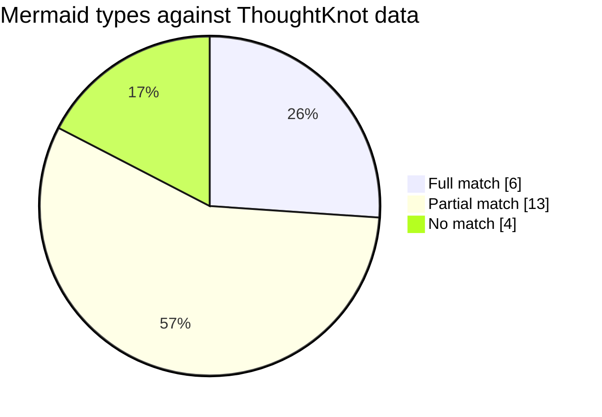

# Mermaid mapping review

Roger asked on 8 November 2026 how much of Mermaid ThoughtKnot could write from its own graphs. This page is the
first pass: each Mermaid diagram type, held against what a ThoughtKnot graph already holds. It is a review for
**soon**, not a plan. Nothing here is built yet beyond what the "Today" section names.

## The short answer

- **6 of 23** Mermaid types can be written from ThoughtKnot data as it is today.
- **13 of 23** can be written once a graph follows a small, named convention (a status, a second date, a number).
- **4 of 23** do not fit: they need ordered messages or bit layouts, which a graph does not hold.

**Why it matters (use what's already there).** Obsidian, GitHub, VS Code, Notion and most wikis draw Mermaid with no
plug-in. A Mermaid block written beside the graph gives every reader a picture, in tools they already have. Mermaid
is a way out to readers, not ThoughtKnot's own renderer. Its layout leaves crossings and stacks labels
(`python/graph_spec/src/graph_svg.py` says why). It slows down past a few hundred boxes.

## Today

What already writes Mermaid:

| Where | What it writes |
| --- | --- |
| `packages/graph-spec/src/views/mermaid.js` (`mermaidGraph`, `mermaidPath`, `legend`) | A flowchart of every thing and link, labelled by reading (GS§5); a path at an altitude (GS§22). **Written groups (clusters) draw as `subgraph`**, nested, with their members inside (gap G1, done) |
| `python/graph_spec/src/graphspec/rules/views.py` | The same text, byte for byte |
| `python/graph_spec/conformance/scripts/graph_spec_diagrams.py` | The spec's example flowcharts, and a state diagram of the lending process (`TRANSITION` links) |
| `packages/core/src/data-formats.ts` | Mermaid (`.mmd`) listed as a format: source, content, layout and export all **planned** (ES§67, DF1, #1301) |

## The matrix

Key: **Full** = writable from today's data. **Partial** = writable with the convention named. **No** = does not fit.

| Mermaid type | Match | ThoughtKnot source | What is missing |
| --- | --- | --- | --- |
| `flowchart` | **Full** (shipped) | Every thing and link; Flow, Network, Tree views | Groups as `subgraph`; shape and colour by kind (`classDef` from rules and looks) |
| `mindmap` | **Full** | Tree or Radial along one relationship (tree_fits) | Only when the graph is a tree; other links are left out, and the doc must say so |
| `timeline` | **Full** | Timeline view, ordered by date (timeline_order) | Things grouped into periods (year, month) for Mermaid's `section` |
| `erDiagram` | **Full** | The schema: `ElementType` per kind and property, `Cardinality` (GS§25) for the crow's feet | Property value types, where a schema does not declare them |
| `requirementDiagram` | **Full** | Requirement-shaped graphs, like our own spec (`Requirement`, `Test`, `proves`, `level`) | A fixed map from our link types to Mermaid's seven (satisfies, verifies, traces and so on) |
| `pie` | **Full** | Group by (DX1) with counts or totals (CV1) | Nothing; it is a total, not the graph |
| `stateDiagram-v2` | Partial | Process graphs: states and `TRANSITION` links with event and guard (lending demo, SCXML export) | Needs the process convention; a general graph has no states |
| `gantt` | Partial | Things with dates (`dates`), links for "after" | A start and an end (or a length) per thing; done or active status; milestones |
| `classDiagram` | Partial | Kinds as classes, properties as fields, a subtype link as inheritance | Methods and visibility have no meaning in ThoughtKnot; leave them out |
| `quadrantChart` | Partial | Two numbers per thing; likelihood and impact (GS§20) is the obvious pair | Which two numbers, and scaling them to 0 to 1 |
| `xychart-beta` | Partial | A number per thing, the Table view | Which number, and which order along the bottom |
| `sankey-beta` | Partial | Flow view and its links | A number on each link (the amount that flows) |
| `kanban` | Partial | Lanes view, the whiteboard | Lanes by a status property, not only by kind |
| `treemap-beta` | Partial | Containment groups and the Treemap view | A number per thing for its size |
| `radar-beta` | Partial | Several numbers per thing | Which numbers, on one scale |
| `block-beta` | Partial | Block and Containment views, groups | Columns and widths Mermaid needs |
| `architecture-beta` | Partial | Groups as boundaries, things as services, links | Icons by kind |
| `C4Context` and friends | Partial | Our architecture graph (`requirements/architecture.gql`), `Person` agents, groups | Kinds named System, Container and Component |
| `journey` | Partial (weak) | Timeline order, `Person` agents, a number as score | A step order, a score 1 to 5, who takes part |
| `sequenceDiagram` | **No** | | Links have no order in time; a sequence is messages, one after another |
| `zenuml` | **No** | | As sequence |
| `gitGraph` | **No** | | Commits and branches are not things in a graph (K1 reads repos, but not as history) |
| `packet-beta` | **No** | | Bit layouts; nothing in ThoughtKnot is shaped like this |

## The gaps, grouped

Five small conventions would turn most Partial rows Full. Each one is a choice that can be challenged.

| Gap | Turns on | Proposal | Challenge it |
| --- | --- | --- | --- |
| **G1 Groups out (done)** | flowchart, block, architecture, C4 | `mermaidGraph` writes groups (ES§6) as `subgraph` | Nested groups get deep fast; cap the depth? |
| **G2 A span of time** | gantt, timeline | A thing with two dates reads as start and end; a `length` number as days | Which two dates, when a thing has three? |
| **G3 Status** | kanban, gantt, state | One property named in the style graph is "the status" | Is a named property better than a kind? |
| **G4 Numbers on links** | sankey | A link's first number is its amount | Links hold properties in GQL, but the view's shape does not carry them yet |
| **G5 Order on links** | sequence, journey | A link `order` number, or links read in written order | Would this turn graphs into scripts, which ThoughtKnot is not? |

## The other way: Mermaid in

Mermaid is also a source (ES§67, format_*). Flowchart, mindmap, ER, class, state and requirement text all read
straight into things and links, each citing its line (ES§63). Pasting a Mermaid block into a note and getting a live
graph is likely the biggest win for new users. It is the same plug-in, the other direction.

## Care points

- **Escaping.** Labels must escape quotes, `<`, `#` and Markdown, and draw with Mermaid's `securityLevel: strict`.
  Today only the double quote is escaped (`caption` in `mermaid.js`).
- **Size.** Mermaid refuses text over 50,000 characters by default and is slow past a few hundred boxes. A big graph
  writes a slice: a path, an ego view or the working set.
- **Dark mode.** Mermaid's own theme does not follow ThoughtKnot's looks; `graph_svg.py` already works around this
  for the Mermaid Zoom plug-in.
- **Same text both sides.** Each new writer is held byte for byte between JavaScript and Python, as `mermaidGraph` is.

## Suggested order, for the soon review

1. Flowchart with groups (G1, **done**) and looks (next). Smallest change, every graph gains.
2. Mermaid in, for flowchart and mindmap. Biggest win for new users.
3. Mindmap, timeline and pie out. Data already there.
4. ER and requirement out. Our own spec becomes the first user.
5. Decide G2 to G5, then the Partial rows.

Backlog item: [#2098](https://github.com/rogerbucks/thoughtknot/issues/2098), "Soon: review Mermaid generation", an idea on the board.
