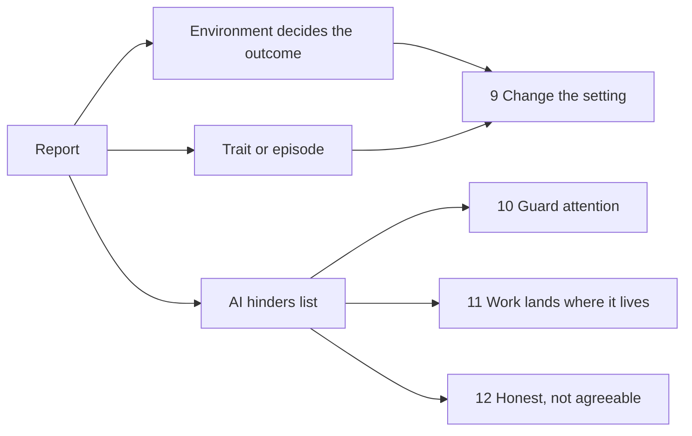

# Neurodivergence and the ethos

Roger shared a report on 8 November 2026: "Neurodivergent presentations in life and work". It covers ADHD, autism,
bipolar disorder and the conditions often found with them. He asked two things. How does it fit ThoughtKnot? And what
should go into the ethos, with a reason that can be challenged?

This page is the answer. The ethos itself lives in `requirements/ethos.gql`, and the wiki's Ethos page is made from it.

## The short answer

- **Most of the report is already in the app.** Presets by need, never disorient, plain words, AI off until chosen,
  and AI answers as proposals all match it.
- **Four new principles** fill the gaps: change the setting, guard attention, work lands where it lives, and honest
  not agreeable.
- **Three new rules** join old principles: routines survive updates, no guessing a condition, and keep the person's
  voice.
- **Two rules are checked today.** The other eleven say plainly that nothing checks them yet, as the ethos demands.

## What already fits

| Report says | ThoughtKnot already has |
|---|---|
| Labels describe support need, not ability | Six presets named by need, never by diagnosis (`view_presets_by_need`) |
| Last-minute change and lost place cost a lot | Principle 8, never disorient; nodes stay put |
| Long, dense text is a barrier | Principle 3, plain words, checked in CI |
| Sensory overload | Reduced motion respected; the device's own settings win |
| Health information is sensitive | Principle 4, notes stay yours; nothing leaves the device |
| AI output can be wrong | Principle 5, the person decides; each AI change is a proposal |

## The new principles

Each line gives the proposal, where it comes from, why, and the best case against it. Push back on any of them.

### 9. Change the setting, not the person

- **Source:** "At work, the environment decides most of the outcome." Support levels describe a setting, not ability.
  Co-occurrence is the rule, and trait or episode is the key test.
- **Why:** a person's needs change with the day and the place. The app should bend, and should never ask why.
- **Rules:** settings named by need (checked); a lighter view one step away, setups kept per place (checked);
  mix parts of two presets (not yet).
- **Challenge:** more settings can overwhelm the very people they serve. Mixing presets invites clashes, such as
  calm (sameness) against focus (novelty). One answer: few starters, mixing tucked away, a clear winner on clashes.

### 10. Guard attention, never harvest it

- **Source:** the ADHD hinders list: the hyperfocus trap, tool-hopping, checking skipped because it is boring. The
  bipolar list: late-night sessions cost sleep.
- **Why:** attention follows interest and novelty. A tool tuned for engagement would serve itself, not the person.
- **Rules:** no streaks, badges, feeds, nags or pings (not yet); an optional AI time box and quiet hours (not yet).
- **Challenge:** a time box can feel like a parent. Roger and many users work at night by choice. Answer: it is off
  by default and the person sets it; the app never decides for them.

### 11. Work lands where it lives

- **Source:** "reminders and plans that live in a chat nobody reopens". Also "written follow-ups, so nothing lives
  only in conversation" and "where was I?" after an interruption.
- **Why:** this is ThoughtKnot's job. Notes and graphs are the real task system. A chat panel is not.
- **Rules:** a kept AI answer becomes a proposed change to a note or graph (checked); a "since you left" view (not
  yet).
- **Challenge:** some chats are only thinking aloud. Forcing them into notes fills the vault with clutter. Answer:
  only what the person keeps lands; the rest goes, and nothing is written behind their back.

### 12. Honest, not agreeable

- **Source:** "Chatbots tend to agree with the user", which can feed grand plans in hypomania. Also reassurance loops
  in anxiety and OCD, and AI's reading of social intent as "a guess presented confidently".
- **Why:** the person decides (principle 5) only works if what they are given is honest about its doubts.
- **Rules, all not yet:** every AI suggestion says how sure it is. It gives the case against as well as for. A
  reading of tone is labelled a guess.
- **Challenge:** the AI model's manner is not ours to control, so these are hard to check. "Both sides" can feel
  cold to someone who needs support. Answer: we control the frame around the answer, such as labels, certainty words
  and contradicts links, not the model.

## New rules under old principles

| Principle | New rule | Source | Challenge |
|---|---|---|---|
| 8 Never disorient | An update never changes saved views, presets or shortcuts without saying so | Autism: tool changes after an update break routines | Some changes must happen; then say so first |
| 4 Notes stay yours | Never guess a condition from use, writing or drawing | "It is not a diagnostic tool"; handwriting is "associated, not diagnostic" | Hard to prove a negative; a review line is the check |
| 5 The person decides | AI edits are the smallest change; rewrite only when asked | Dyslexia and autism: rewrites lose the person's voice | Small edits can miss a real fix; the person can still ask for more |

## Left out on purpose

- **Features per condition.** The report shows conditions mix and overlap. Presets by need already cover this.
- **Crisis and clinical claims.** ThoughtKnot is a notes tool. It should not claim to be a crisis service, so it
  stays silent rather than half-doing it.
- **Prevalence figures and the law.** Useful background, but they do not change how the app behaves.

## Follow-ups

- **Handwriting input** is in the backlog as a future feature.
- **Mermaid diagrams from ThoughtKnot data** are in the backlog for a soon review.
- **Each "not yet" rule** needs a requirement before it can be built. Roger's yes on the principles comes first.
