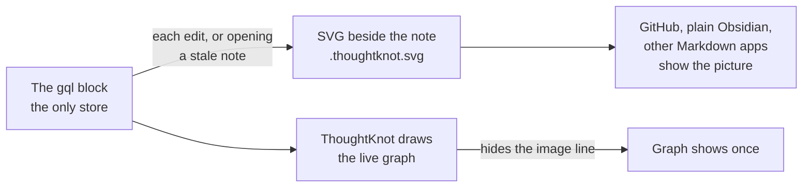

# Picture for readers design

Roger asked on 24 October 2026 for a picture of a graph that people can read without ThoughtKnot. With ThoughtKnot,
the live graph shows instead. This page is the design. The requirements are editor spec section 62, workstream RP1.

## The short answer

Each graph block can keep an SVG picture of its drawing, saved beside the note. A plain Markdown image line straight
after the block shows it.

- **Without ThoughtKnot** (GitHub, Obsidian with no plug-in, other Markdown apps): the reader sees the GQL text, then
  the picture.
- **With ThoughtKnot**: the plug-in draws the live graph and hides the image line, so the graph shows once.

````markdown
```gql
(alice:Person {name: 'Alice'})-[:KNOWS]->(bob:Person {name: 'Bob'})
```

````



## How it works

| Question | Answer |
| --- | --- |
| Where is it kept? | Where the host keeps new attachments, or a folder you set. Named after the note and the graph. |
| How does ThoughtKnot know it? | The file name ends `.thoughtknot.svg`, and the line comes straight after a gql block. |
| How does it stay in step? | The picture carries a fingerprint of the block and style text. Each edit redraws it. Opening a note with an old picture redraws it. |
| Does it churn sync or Git? | No. Every host draws the same bytes, and the file is written only when they change. |
| Is it ever read back? | Never. The text stays the only store. Deleting the picture loses nothing. |
| Is it on by default? | No. Turn it on for one note, a folder or the vault. |
| Is it readable? | It has its title, legend, a "drawn by ThoughtKnot" line and its own background. Its alt text is the plain-language reading. |
| A huge graph? | Its first view or an overview, with a line counting what is left out. |
| A secret note? | A note above the classification level gets no picture until you confirm. |
| Edited by hand, or in GitHub? | A command line brings every picture in a folder up to date. A CI check can fail on an old one. |

## What already exists

- **Export** (§16) already makes SVG and PNG with title, legend and a fixed theme. The picture reuses it.
- **The Python reader** draws the same layout as the plug-in (`graph_svg.py`), so CI can redraw pictures.
- **Schema-only blocks** are already drawn as pictures inside ThoughtKnot (PR #564). That is not the same thing: it
  needs the plug-in.

## Choices not taken

- **A Mermaid copy of the graph.** GitHub and Obsidian draw Mermaid with no plug-in. But it would be a second copy of
  the data in the note, its layout would differ from ThoughtKnot's, and a large graph reads badly.
- **PNG.** It is not text, so Git cannot show what changed, and it grows with every edit. SVG is text and sharp at any
  size.
- **An HTML comment as the marker.** Obsidian's reading view drops comments before the plug-in sees the page, so the
  file name is the marker instead.
