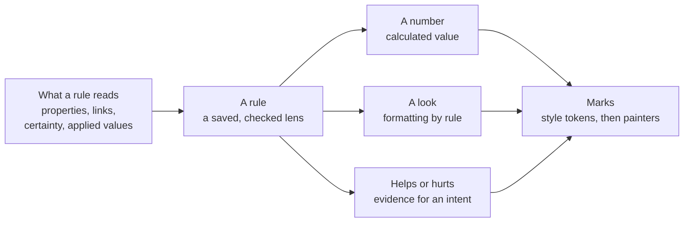

# Rules, intents and calculated values design

This page covers four ideas Roger raised on 23 October 2026. They are formatting by rule, AI sorting, intents and
calculated values, plus more help for large graphs. It is the design study, and Roger took every recommendation the
same day. The requirements are editor spec sections 56 to 60. They are built in Waves 16 to 20, straight after the
Obsidian community release (R2).

## The short answer

One building block does three jobs. A **rule** is a saved, checked query: a lens (§33). A rule can give:

- **a number**: a calculated value, such as a total;
- **a look**: formatting by rule, such as "overdue gets a red outline and a clock";
- **helps or hurts**: evidence for an intent.

An AI never sits inside a rule. Its suggestions become inputs only after a person applies them.



## Formatting by rule (§56)

- A `Look` in the style graph carries a short `when`, or names a lens. A `when` runs as a lens, so both engines agree.
- A look is never colour alone. It also adds a badge, a line or a shape. It reaches the drawing as a style token.
- Looks apply in the order written. Two looks that set the same part of one thing are reported as a clash.
- The legend is made from each rule's meaning.
- On a massive graph, each group box counts its looks, and the filters offer a "By look" facet.
- In reading view a rule is only tried. In edit mode it is saved.

```gql
// graph: tasks_style · STYLE tasks
(late:Look {when: "due < today() AND status <> 'done'", colour: 'red', badge: 'clock', means: 'Overdue'}),
(big:Look {lens: 'over_budget', line: 'thick', means: 'Over budget'})
```

## Calculated values and the table view (§57)

- A kind's schema declares a calculated property as a GQL expression, with its unit.
- Tools work it out each time (spec §24, rule 4). It is never written into the note (spec §11).
- A total says how many things lack the value. It never counts them as zero. Adding pounds to hours is refused.
- A value that depends on itself shows as a loop.
- The filters show totals beside their counts, in under 100 ms for 10,000 kept things.
- A new table view shows things as rows and properties as columns, with a total under each number column.

```gql
(cost:Calculated {of: 'Task', is: 'price * quantity', unit: 'GBP'}),
(total:Calculated {of: 'Project', is: "sum(cost) over <-[:PART_OF]-", unit: 'GBP'})
```

## Intents (§58)

- An `Intent` says, in the person's own words, what they are trying to reach. It may carry a test that tools check.
- Things link to it with `SUPPORTS` or `CONTRADICTS`, each with a certainty word and a reason (§28).
- Its standing is counted by tools: what supports it, what contradicts it, and what is not linked yet.
- The process intent checks of §35 become intents with a test, so there is one idea, not two.
- First, any view can show a chosen intent as an overlay. Then a pole view places things near the intents they support.
  With two intents it can be one axis.
- On a massive graph, the poles place groups, which glide. Nothing is laid out from scratch.

## AI suggestions (§59)

A person always applies an AI change. So an AI only suggests a value or a link, with a certainty word and a reason.
The suggestions wait in the review lens, grouped by value. A person checks a sample and applies a group in one step,
and it rolls back in one step. Reading view can preview a suggested look, drawn dashed. An AI never decides a look, a
number or a place as a drawing is made.

## Discovery in large graphs (§60)

| Function | What it does |
| --- | --- |
| Group by anything | Group the overview by any property, look, intent or lens bucket |
| Gap and outlier lenses | Find things with nothing linked, missing what their schema needs, unusual numbers, stale things and near-duplicate names |
| Bulk edit | Set a property on everything kept, as one reviewed change |
| Saved trails | Save an exploring trail as a lens or a path |
| Working set | Pin things from anywhere, then view, edit or export just those |
| Ask in plain words | An AI writes a read-only query, shown with its count before it runs |
| As at a date | Show the graph as it was on a day, and what changed since |
| Compare sets | What is in one lens, the other, or both |
| Group names | An AI suggests names for groups found by links, applied by a person |
| Watch a rule | Be told when a rule starts or stops matching, once the engine runs in the background |

## Decision

Roger, 23 October 2026: "All recommendations". The five waves go straight after R2, ahead of the held waves, which
are now Waves 21 to 35.
