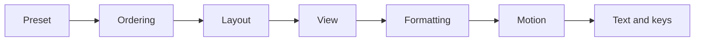

# View presets design

Roger asked on 25 October 2026 which orderings, layouts and views suit different brain types, with WCAG kept in mind.
He also asked that every choice be saved for later. This page is the plan. The requirements are editor spec section
69, workstream VP1. The research behind it is summed up below.

## The short answer

- **Presets are named by need, never by diagnosis.** People inside one group differ more than the groups differ.
- **Every choice saves on its own, and a named preset bundles them.**
- **WCAG 2.2 AA is a floor.** No preset goes below it, and the device's own settings win.
- **The default for everyone is a 2D drawing with an outline beside it.** 3D, VR and fisheye stay as extras.

## Built so far

The six starters are in `packages/core/src/view-presets.ts`. **View preset** heads the Drawing settings: picking one
sets every Drawing setting it turns, and each stays yours to change. The floor, the device winning, the nearest
preset winning and the one-file export are there too.

- **Motion:** moving links have a pause beside their legend. A still preset stops them as reduced motion does.
- **Reading support:** long labels cut short, words spaced wider, the details read aloud. O shows the outline.
- **Focus support:** the rest is blurred, not hidden, and a trail of picks is kept to go back along.
- **Changing preset:** a preset picked first says what it would change. It is used only when asked, and undone in one
  step.
- **Next:** a graph or vault keeping its own preset, the device's lines beside the drawing, and laying out again only
  when asked.

A preset sits beside a personal profile (section 39). The preset says how a graph is drawn. The profile says how much
of it a viewer is shown.

## Starter presets

| Starter | Ordering | Layout | View | Motion | Extra |
| --- | --- | --- | --- | --- | --- |
| Default | By flow | Rows, or stress for a network | 2D and outline | Follows the device | AA floor |
| Focus support | Hubs first | Rows, the focus in the middle | 2D, the rest blurred | Off | A trail of recent picks |
| Calm and predictable | One order the person picks | Pinned, laid out again only when asked | 2D or grid | Off | A preview before a change |
| Detail first | By name or property | Grid or matrix | Matrix or outline | Off | Every label shown |
| Big picture first | By kind or group | Groups as boxes, folded | Semantic zoom | Optional | One key to fit all |
| Reading support | By flow or kind | Rows, short labels | 2D and outline | Follows the device | Wider spacing, read aloud |

## Why each starter

Each starter's choices, the research behind them, and how sure that research is. **Looked at again:** 28 October
2026. Look again when a source below changes or a new study is found, and change this table first.

| Starter | Choice | Why | How sure | Source |
| --- | --- | --- | --- | --- |
| Default | 2D drawing with an outline beside it | No general gain from 3D, and it hurts memory of where things are | Medium | Kotlarek 2020, Schroeder 2018 |
| Default | Motion follows the device, a pause for anything moving | Moving content needs a pause and must stop on request | High | WCAG 2.2 (2.2.2, 2.3.3) |
| Focus support | The selected thing and two links round it, the rest blurred | ADHD readers prefer blurring to hiding, and keep the context | Medium | Zhu 2025, Forster and Lavie 2023 |
| Focus support | A trail of recent picks to go back along | Hyperfocus makes "where was I" hard | Low | Bowen 2026, Zhu 2025 |
| Focus support | Nothing moves by itself | A distractor holds ADHD attention longer once it catches it | Medium | Zhang 2024 |
| Calm and predictable | Laid out again only when asked, pinned things stay | Uncertainty and surprise raise anxiety for many autistic people | High | Jenkinson 2020, WCAG 2.2 (3.2.5) |
| Calm and predictable | A preview before a change, undone in one step | Unexpected changes overwhelm some readers | Medium | Wu 2023, W3C COGA 2021 |
| Detail first | Matrix or grid, every label shown | A matrix suits a dense graph; no general local bias, so a style to choose, not a group's | Low | Okoe 2018, Van der Hallen 2015 |
| Big picture first | Groups folded into boxes, one key to fit all | Seeing the whole takes longer for autistic readers, so start from it | Medium | Van der Hallen 2015, Alpizar 2020 |
| Reading support | Plain sans font, no special dyslexia font | Fonts made for dyslexia do not help | High | Wery 2017, Kuster 2018, Galliussi 2020 |
| Reading support | Wider word spacing, a line height of 1.5, short labels | Wider word spacing helps a little; style guides agree | Medium | Galliussi 2020, British Dyslexia Association |

## What the research says

| Finding | How sure | Source |
| --- | --- | --- |
| Almost no study tests these groups reading node-link graphs | High | Wu 2026, Tran 2024 |
| With ADHD, a distractor holds attention longer once it catches it | Medium | Zhang 2024 |
| A busy but relevant view distracts less than a sparse one | Medium | Forster and Lavie 2023 |
| ADHD readers prefer blurring the rest to hiding it, and saved presets | Medium | Zhu, ASSETS 2025 |
| No evidence that ADHD subtypes need different layouts | Medium | Search found none |
| Autistic readers see the whole more slowly, not worse at it | High | Van der Hallen 2015 |
| Uncertainty and surprise changes raise anxiety for many autistic people | High | Jenkinson 2020 |
| Fonts made for dyslexia do not help; wider word spacing does a little | High | Wery 2017, Kuster 2018, Galliussi 2020 |
| 3D hurts memory of where things are | Medium | Kotlarek 2020 |
| A matrix suits a dense graph, a node-link drawing a sparse one | High | Okoe 2018 |

The full research, with 34 sources and a confidence for each choice, is kept with the project files
(`neuro-layouts/research.md`).

## Safe for everyone

- Contrast at least 4.5:1 for text and 3:1 for shapes and focus.
- Colour never the only cue: a shape or an icon too.
- Motion follows the device; nothing plays by itself; a pause for anything past five seconds.
- Laid out again only on request; pinned things stay put.
- Every action by keyboard, with undo and a way that needs no dragging.
- The outline always one key away.
