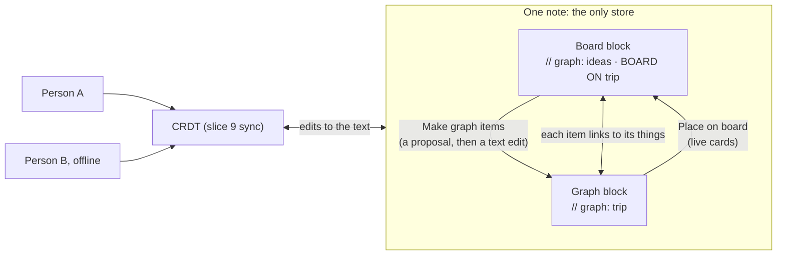
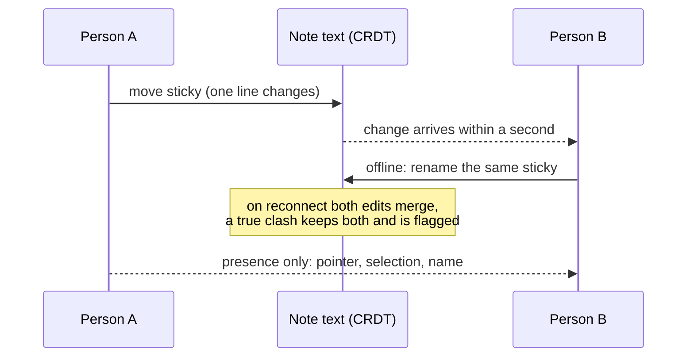
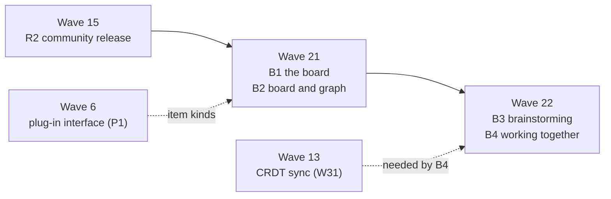

# Whiteboard design

A whiteboard view for brainstorming, with several people at once, that knows the graph. Anything on the board can
become things and links in a graph. Anything in a graph can be put on a board. Designed on 17 October 2026, against
version 0.5.0, at Roger's request.

The requirements are section 45 of
[`requirements/editor-requirements.md`](https://github.com/rogerbucks/thoughtknot/blob/main/requirements/editor-requirements.md),
slice 10, in workstreams B1 to B4. They are built in Waves 21 and 22 of
[`requirements/waves.json`](https://github.com/rogerbucks/thoughtknot/blob/main/requirements/waves.json), after the
Obsidian community release (R2). Roger's rule is that what he adds now goes after R2.

## The short answer

| Ask | Design |
|---|---|
| A whiteboard view | A note opens as a board: stickies, cards, text, shapes, frames, connectors, ink, images and glyphs |
| Works well with graphs | The board is itself a graph, kept as a block in the note, so it is checked, diffed and versioned like any graph |
| Decompose into graph items | Select, then *Make graph items*: items become things, connectors become links, frames become groups. Shown as a proposal first |
| Relationships | Links between things on the board are drawn as connectors; connectors become links with a reading |
| Brainstorming | Type to capture, Enter for the next idea, Tab for a child; group, vote, templates, a timer |
| Multi-user editing | Live, local first and offline, through the CRDT already planned for sync (`crdt_transport`), with no server |

## How it fits

## 1. The board is a graph, kept in the note

**Why.** The editor already promises that the note's text is the only store (`text_is_the_store`) and that every edit
is written to that text first (Q-06). A board kept anywhere else would break both, and could not be diffed, reviewed
or synced the way graphs are.

**Design** (`board_is_text`, `board_items`).
- A board is a fenced gql block whose graph line says `BOARD`, as a style block says `STYLE`:
  `// graph: ideas · BOARD ON trip`. `ON` names the data graph its items decompose into; without it, it is a free board.
- Each item is a node of a small, fixed set of kinds: `Sticky`, `Card`, `Text`, `Shape`, `Frame`, `Ink`, `Image`,
  `Glyph`. Its place, size, text, layer and style are properties. A connector is an edge, `CONNECTS`, with its label
  and arrow ends.
- Positions are whole numbers and properties are written in a fixed order. So moving one item changes one line, and the
  same board is always the same bytes.
- Style is design tokens only (`--gn-*`), so a board follows the theme, forced colours and right to left like every
  other view (`board_look_and_direction`).
- Ink is stored as a simplified path, and images as links to attachments, never inlined, so the block stays readable.
- The board graph is checked like any graph (`board_checked`). An unknown kind, or an item linked to a thing that is
  gone, is a problem with a fix. The board still draws what it can.

**Fits the design review.** Item kinds and templates are an extension point of the plug-in interface
(`points.boardItems.add`, `board_item_plugins`), with a contract suite like every other point. Words come from the
catalogue; arrow keys follow reading direction.

## 2. From the board to the graph, and back

**Make graph items** (`board_to_graph`). Select anything and choose *Make graph items*:

| On the board | Becomes in the graph |
|---|---|
| A sticky, card or text | A thing; its kind is chosen, or suggested from the graph's kinds |
| A list inside one item | One thing per line, joined to the item's thing |
| A connector with a label | A link; the label is its reading |
| A frame around items | A group (cluster) of their things |
| A card's properties | The thing's properties |

- It is always shown first as a proposal, with the same accept and reject flow as AI proposals (W8). It is written to
  the graph block only when accepted. Undo takes back both blocks in one step.
- An AI may propose the decomposition (`board_ai_decompose`): names, kinds and links from a wall of stickies. It is off
  until chosen and arrives as proposals, one by one.

**Linked both ways** (`board_graph_linked`, `board_link_kept`). The item keeps `graph: 'thing_id'`. The item shows a
mark; the thing's details say *On board: ideas*, and each opens the other. A rename follows both ways. Deleting either
side never deletes the other: the survivor is marked unlinked, and the problem offers to relink or remove it.

**Graph onto the board** (`graph_on_board`, `board_relations_drawn`). Drag things, links or a saved view onto a board.
They become live cards: an edit to the card is an edit to the graph, and the card follows the graph. Links between
things on the board are drawn as connectors in the drawing's style, behind one switch. Items can be arranged by any
diagram type the graph fits (`board_arranged_by_graph`).

## 3. Brainstorming

- **Capture** (`board_quick_capture`): type on an empty spot for a sticky, Enter for the next, Tab for a child joined
  to it. A mind map is just this, and decomposes into a tree.
- **Group** (`board_cluster`): group stickies into frames by shared words or tags, on the device; by an AI only when
  chosen.
- **Vote and react** (`board_vote`): per person, tallied per item, kept in the board block.
- **Templates** (`board_templates`): mind map, affinity map, two by two matrix, flow, retrospective. Each is a board
  note, so people can make their own, and plug-ins can add more.
- **Facilitation** (`board_facilitation`): a shared timer, and new notes hidden until revealed.

## 4. Several people at once

**Default chosen:** local first, through the CRDT that slice 9 already plans to carry every edit at the level of the
text (`crdt_transport`, Automerge). It is peer to peer and encrypted, with no server deciding what is true.

- **Live** (`board_live_together`): changes appear for others within a second on a shared network.
- **Offline** (`board_offline_merge`): edits merge on reconnect with nothing lost; a clash keeps both sides and is
  flagged, as joined graphs already do (`conflicts_flagged_kept`).
- **Presence** (`board_presence`): pointers, selections and names, each marked by more than colour; follow a person.
  Presence is sent beside the CRDT and never written to the note.
- **Access** (`board_access`): view, comment and edit follow the permission rules of section 39; people join by an
  encrypted invitation, and keys never leave their devices.
- **Authorship and undo** (`board_authorship`): each change names its author in the provenance log (Q-03), and undo
  takes back only your own changes.
- **Comments** (`board_comments`): threads on any item, resolved when done.

## 5. Speed, access and exchange

- **Speed** (`board_speed`): 5,000 items at 60 frames a second, opening within a second on a recent phone, checked by a
  benchmark in CI. Only what is on screen is drawn.
- **Keyboard and screen readers** (`board_keyboard`). Every action works by keyboard. Every item is announced with its
  kind, text and connections, and an outline view shows the board as text. Whiteboards are often unusable without a mouse; this
  one must not be.
- **Exchange** (`board_exchange`): import and export JSON Canvas, the open format of Obsidian Canvas, plus SVG, PNG and
  PDF.

## Build order

Small pull requests, each a spec, a test that fails first, then code:

1. The board block: read, write and check it (`board_is_text`, `board_checked`).
2. The board view with stickies, text and connectors, by pointer and keyboard (`board_view`, `board_keyboard`).
3. The other item kinds, cards and glyphs.
4. Make graph items, as a proposal, and the two-way link.
5. Live cards and drawn relations.
6. JSON Canvas and image exports; the speed benchmark.
7. Brainstorming tools and templates.
8. Live editing, presence, offline merge and access, on the slice 9 CRDT.

## Choices made, and the alternatives

| Choice | Picked | Not picked, and why |
|---|---|---|
| Where the board lives | A gql block in the note | A separate JSON file: breaks *text is the store* and graph diffing |
| File format | Board graph, with JSON Canvas import and export | JSON Canvas as the store: cannot link items to things or be checked as a graph |
| Multi-user | The planned CRDT, peer to peer | A hosted server (tldraw sync, Liveblocks): a server would decide what is true, and it needs to be online |
| When | Waves 21 and 22, after R2 | Earlier: against Roger's rule for new additions |
