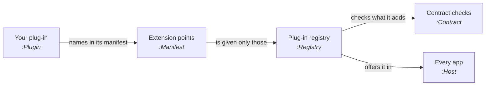

# Writing a plug-in

A plug-in adds something to ThoughtKnot through one typed, versioned interface. The built-in exports use the same
interface, so a plug-in is never second class.

<!-- wiki:edition -->

## How it fits



1. Your plug-in names itself, its version, the interface version it was built for and the extension points it uses.
2. The registry gives it those points and nothing else.
3. Everything it adds is checked as it is added. If one thing is refused, none of it is installed.
4. Once installed, what it adds is offered in every app: Obsidian, the browser editor and, later, the standalone app
   and VS Code.
5. If your code throws while running, ThoughtKnot catches it and names your plug-in. A drawing is never left blank.

The interface is version <!-- wiki:plugin-api -->. It and each extension point carry a version, major.minor:

- A plug-in built for the same major and a minor no higher loads. Any other is refused.
- Name each point with the version you built for, such as `exports@1.0`. A point named with no version counts as
  `@1.0`.
- When one point moves to a new major, only plug-ins that use it are refused, and the message names that point.

A sample plug-in sits outside the packages, in
[`examples/sample-plugin`](https://github.com/rogerbucks/thoughtknot/tree/main/examples/sample-plugin). CI runs it the
way a host runs one it did not ship: in a worker, held to each point's contract.

## Extension points

<!-- wiki:plugin-points -->

Diagram types, graph steps and sources, storage, AI providers and commands join these one at a time, each with its own
contract checks.

## A first plug-in

This plug-in adds a plain text export: one line for each thing, then one for each link. The wiki's tests install
this exact code, so it always works with the current interface.

```js
import { PLUGIN_API, pluginRegistry } from '@thoughtknot/core';

const textList = {
  id: 'acme.text-list',
  version: '1.0.0',
  api: PLUGIN_API,
  uses: ['exports'],
  register: (points) => {
    points.exports.add({
      format: 'text-list',
      title: 'Text list',
      extension: 'txt',
      mime: 'text/plain',
      write: (data) =>
        [
          ...data.things.map(([id, kinds]) => `${id} (${kinds.join(', ')})`),
          ...data.links.map(([from, type, to]) => `${from} ${type} ${to}`),
        ].join('\n'),
    });
  },
};

const registry = pluginRegistry();
registry.register(textList);
```

### The rules a plug-in is held to

- **Its id** is dotted lower-case words, such as `acme.text-list`. Use your own name first, so no two plug-ins clash.
- **Its version** is major.minor.patch.
- **Its file** is one file. It exports only the plug-in, written `export default` at the start of a line. It holds no
  `import`, not even in a comment, so bundle what you need into it. A host refuses any other file before running it.
- **No code from text.** `eval`, `Function` and timers given text are taken away before the file's first line runs.
- **Its writer** gives the same text every time for the same graph, and never changes the graph it is given.
- **Its colours**, if it adds any, are named `--gn-plugin-<your-id>-<word>`. Each gives a light and a dark colour that
  meets the locked contrast on the background it sits on.

## Check your plug-in

Run the contract checks against your own plug-in in your tests. They need no test framework: each check throws,
saying what was wanted, when something breaks a promise.

```js
import { exporterContract } from '@thoughtknot/core';

for (const check of exporterContract(myExporter)) check.run();
```

<!-- wiki:plugin-checks -->

## Colours: the design tokens

A plug-in's styles may use any of the core's design tokens, so it follows the app's theme, light or dark, with no work.
The app's own theme always wins: each token reads the app's own colours where it is shown.

<details>
<summary>Every design token</summary>

<!-- wiki:theme-tokens -->

</details>

## Built in

These come with ThoughtKnot, added through the same interface:

<!-- wiki:built-in-plugins -->

## Where it stands

Today plug-ins are built into ThoughtKnot. Loading one from outside, with its manifest limiting what it may reach, is
being built under the requirements below.

<!-- wiki:section 43 -->
